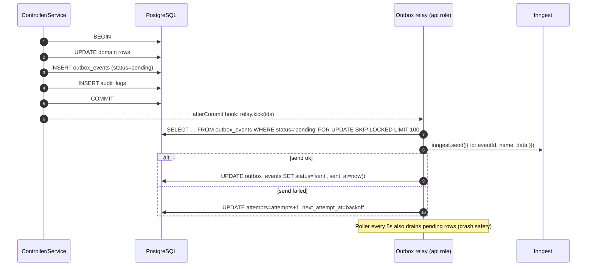
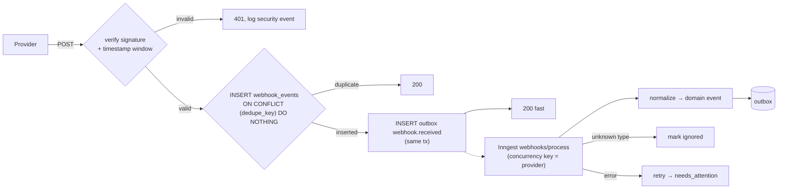

# Data Flow, Events and Source-of-Truth Rules

Related: [system-architecture.md](system-architecture.md) · [ADR-003](../adr/003-postgresql-source-of-truth.md) · [reliability-patterns.md](../engineering/reliability-patterns.md) · [database-design.md](../engineering/database-design.md)

---

## 1. Principles

1. **State changes first, effects second.** A command commits Postgres state plus outbox events in one transaction. Side effects (Inngest events, external API calls) happen after commit.
2. **Inbound first, process later.** Every webhook is persisted to the inbox before it is acknowledged. Processing is asynchronous and idempotent.
3. **Events carry IDs, not data.** Event payloads hold identifiers plus minimal routing fields. Handlers re-read Postgres. This keeps PII out of Inngest and avoids stale snapshots.
4. **Every external effect is an `action_execution`.** No adapter call happens outside the `IntegrationGateway`, which records it.

## 2. Event taxonomy

| Category | Examples | Producer | Consumers |
|---|---|---|---|
| **Domain events** (internal facts) | `workshop.published`, `workshop.activated`, `workshop.paused`, `session.rescheduled`, `registration.created`, `registration.payment_status_changed`, `activity.completed`, `attendance.imported` | Domain modules via outbox | Automation triggers, timeline dependency resolver, sync jobs, SSE |
| **Engine control events** | `timeline/activity.armed`, `timeline/activity.disarmed`, `automation/execution.requested`, `sync/sheet.requested` | Timeline/automation modules via outbox | Inngest functions |
| **Normalized external events** | `zoom.session.started`, `zoom.session.ended`, `zoom.participant.joined`, `zoom.recording.completed`, `comms.delivery.reported`, `sheets.rows.changed` | `webhooks/process` and reconciliation jobs | Timeline (event-mode activities), automation, participants |
| **Raw webhooks** | Zoom `meeting.ended`, comms callback | External systems | Inbox only |

Naming: `<domain>.<entity>.<past-tense-verb>` for facts. `<engine>/<entity>.<imperative>` for control events. Every event schema is defined once in `@wos/contracts/events` as a Zod schema and registered with Inngest via `eventType()` ([v4](https://www.inngest.com/docs/reference/typescript/v4/migrations/v3-to-v4)).

Common envelope fields (inside `data`):

```json
{
  "eventId": "evt_01J…",          // ULID; also used as Inngest event `id` (24h dedupe)
  "occurredAt": "2026-11-15T02:30:00Z",
  "correlationId": "cor_01J…",     // follows a chain: admin command → events → actions
  "causationId": "evt_01H…",       // the event that caused this one
  "actor": { "type": "user|system|webhook", "id": "usr_…" },
  "workshopId": "wks_…"            // routing / concurrency key when applicable
}
```

## 3. Transactional outbox



- **Exactly-once into Inngest is not required.** The event `id` gives Inngest a 24 h dedupe window **[VERIFIED]**, and every consumer is idempotent anyway.
- `FOR UPDATE SKIP LOCKED` lets several `api` instances relay concurrently without double-sending.
- Relay failures beyond 10 attempts → alert `outbox.stuck`. Rows are retained 30 days, then pruned.

## 4. Webhook inbox



Dedupe keys per provider:

| Provider | Dedupe key |
|---|---|
| Zoom | `sha256(event + event_ts + payload.object.uuid/id + participant.user_id/participant_uuid?)` (Zoom does not document a unique delivery ID; we derive one) **[ASSUMPTION]** |
| Comms callbacks | `X-WOS-Delivery-Id` header (contract requirement), fallback `sha256(body)` |
| Apps Script sheet nudge | `bindingId + floor(ts/10s)` (coalesces bursts) |
| Generic registration intake | `Idempotency-Key` header (required) |

## 5. Source-of-truth matrix (per data item)

| Data item | Written by | Read by | Conflict rule |
|---|---|---|---|
| Workshop/session schedule | Admin (platform) | Zoom, Calendar (projections) | Platform wins. External drift is surfaced, not auto-overwritten (MVP) |
| Participant identity fields | Platform **or** Sheet inbound columns **or** registration intake | Everyone | Column owner rule ([ADR-011](../adr/011-google-sheets-sync-ownership.md)). Last-writer-wins only within the same owner |
| Payment status | **[CONFIRM Q4]** external payment system / sheet / manual | Automation conditions | Owner defined per deployment |
| Attendance raw records | Zoom (reports API + webhooks) | Platform | Reports API overrides webhook-derived records once available |
| Attendance %, completion status | Platform (computed) | Sheets, Docs, comms | Platform wins. Manual overrides recorded with reason |
| Message delivery status | Existing comms system (callback) | Platform | Callback wins over our "accepted" status |
| Zoom join URL (per registrant) | Zoom | Platform → comms variables | Refetched on demand if stale |
| Calendar event | Platform | Google Calendar | Platform wins. Deterministic event IDs |

## 6. End-to-end example: registration via Google Sheet

```mermaid
sequenceDiagram
  autonumber
  participant GS as Google Sheet
  participant RC as Inngest sheets/reconcile (cron 5m)
  participant PG as PostgreSQL
  participant AE as Automation engine
  participant WA as Existing WhatsApp system
  participant EM as Existing email system
  RC->>GS: values.batchGet(mapped range)
  RC->>PG: diff vs sheet_row_links (hash)
  RC->>PG: TX: upsert participant + registration, link row, outbox registration.created
  RC->>GS: values.batchUpdate(write wos_registration_id, status) [debounced]
  PG-->>AE: registration.created → workflow "Registration" v3
  AE->>PG: step: dedupe/validate (email, E.164 phone)
  AE->>WA: step: trigger registration_confirmation (Idempotency-Key)
  WA-->>AE: 202 accepted {externalId}
  AE->>EM: step: trigger registration_confirmation
  EM-->>AE: 202 accepted
  AE->>PG: action_executions succeeded; registration.confirmation_sent
  WA-->>PG: (later) callback delivered → comms.delivery.reported
```

## 7. Data retention (proposed, [CONFIRM Q15])

| Data | Retention |
|---|---|
| Workshops, registrations, attendance | Indefinite (business records) or per client policy |
| `action_executions`, `activity_runs`, `workflow_executions` | 24 months, then archived to R2 (Parquet/JSONL) |
| `action_attempts` (request/response summaries) | 6 months |
| `webhook_events` raw payloads | 30 days (payload nulled), metadata 12 months |
| `outbox_events` | 30 days after sent |
| `audit_logs` | 7 years (append-only) **[CONFIRM legal]** |
