# Architecture Diagrams

All diagrams are Mermaid and render on GitHub and in most Markdown viewers. Feature documents embed the relevant diagrams. This page collects them in one place.

Contents:
1. [Overall system architecture](#1-overall-system-architecture)
2. [Frontend ↔ backend communication](#2-frontend--backend-communication)
3. [Workshop lifecycle](#3-workshop-lifecycle)
4. [Timeline execution engine](#4-timeline-execution-engine)
5. [Automation workflow execution](#5-automation-workflow-execution)
6. [Reminder execution sequence](#6-reminder-execution-sequence)
7. [Integration architecture](#7-integration-architecture)
8. [Event and webhook processing](#8-event-and-webhook-processing)
9. [Database ER diagram](#9-database-er-diagram)
10. [Failure handling and retry flow](#10-failure-handling-and-retry-flow)
11. [Workshop rescheduling](#11-workshop-rescheduling)
12. [Deployment architecture](#12-deployment-architecture)
13. [Sequence: registration](#13-sequence-registration)
14. [Sequence: workshop publish & activation](#14-sequence-workshop-publish--activation)
15. [Sequence: Zoom session creation](#15-sequence-zoom-session-creation)
16. [Sequence: attendance synchronization](#16-sequence-attendance-synchronization)
17. [Sequence: workshop completion](#17-sequence-workshop-completion)
18. [Execution state machine](#18-execution-state-machine)

---

## 1. Overall system architecture

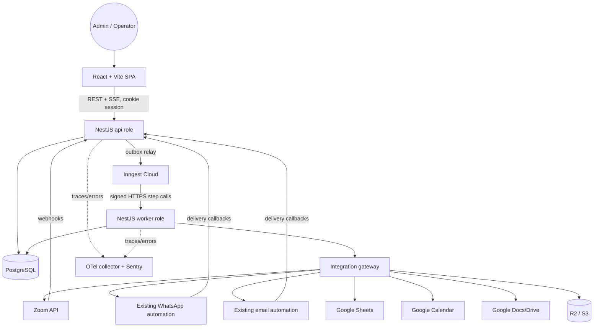

## 2. Frontend ↔ backend communication

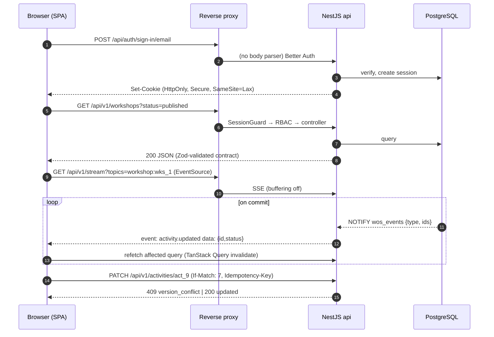

## 3. Workshop lifecycle

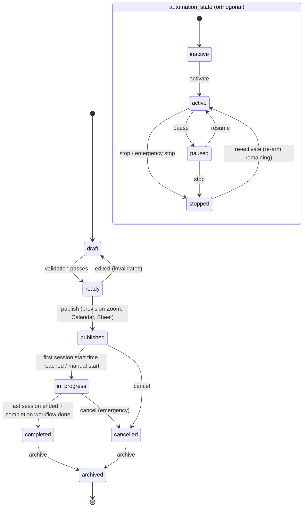

## 4. Timeline execution engine

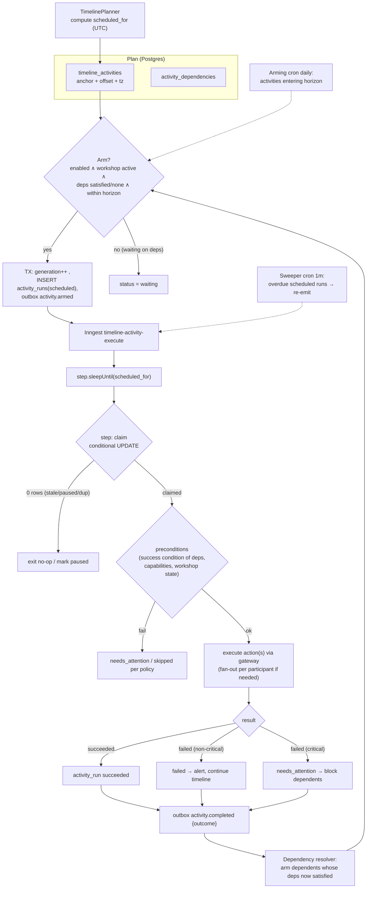

## 5. Automation workflow execution

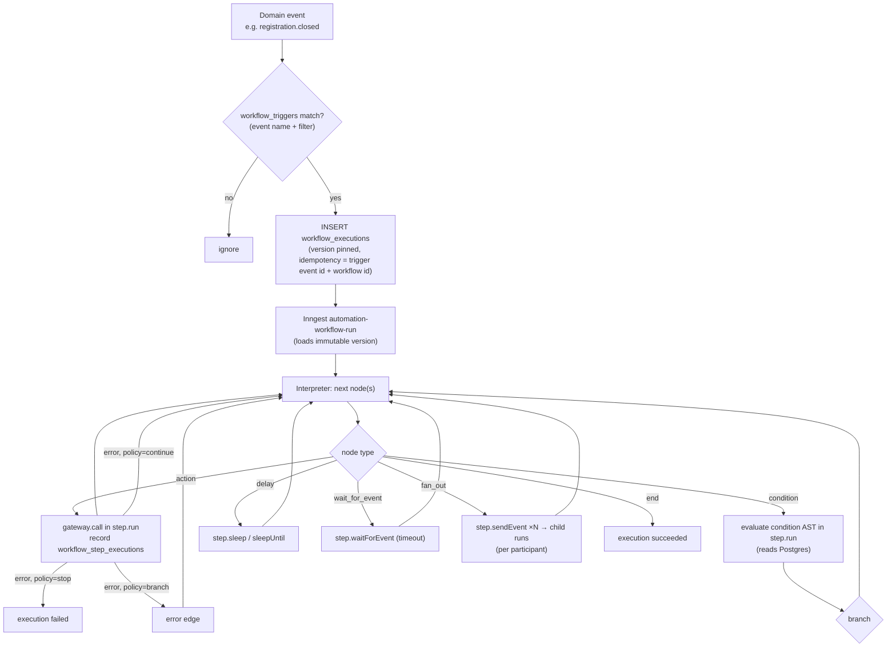

## 6. Reminder execution sequence

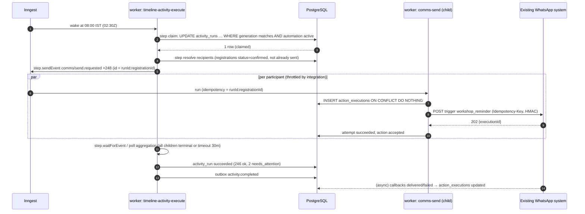

## 7. Integration architecture

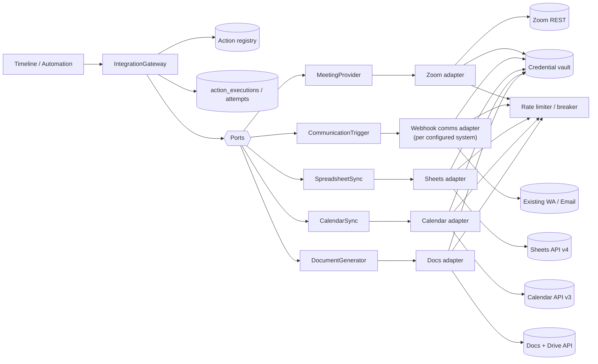

## 8. Event and webhook processing

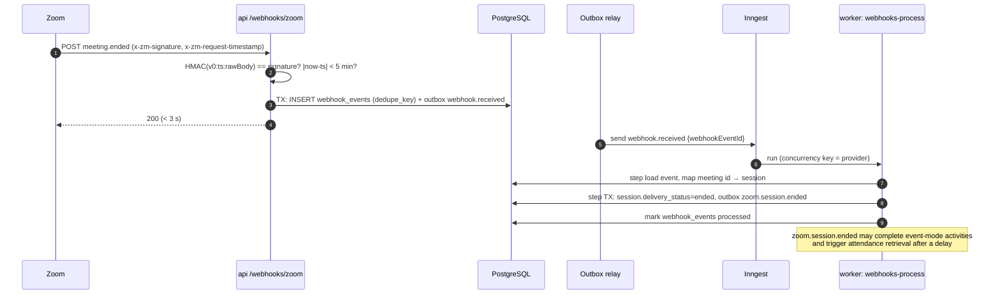

## 9. Database ER diagram

Core relationships (full column definitions: [database-design.md](../engineering/database-design.md)).

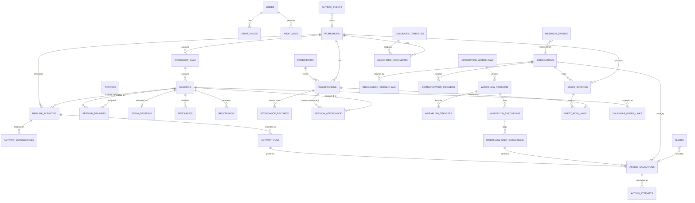

## 10. Failure handling and retry flow

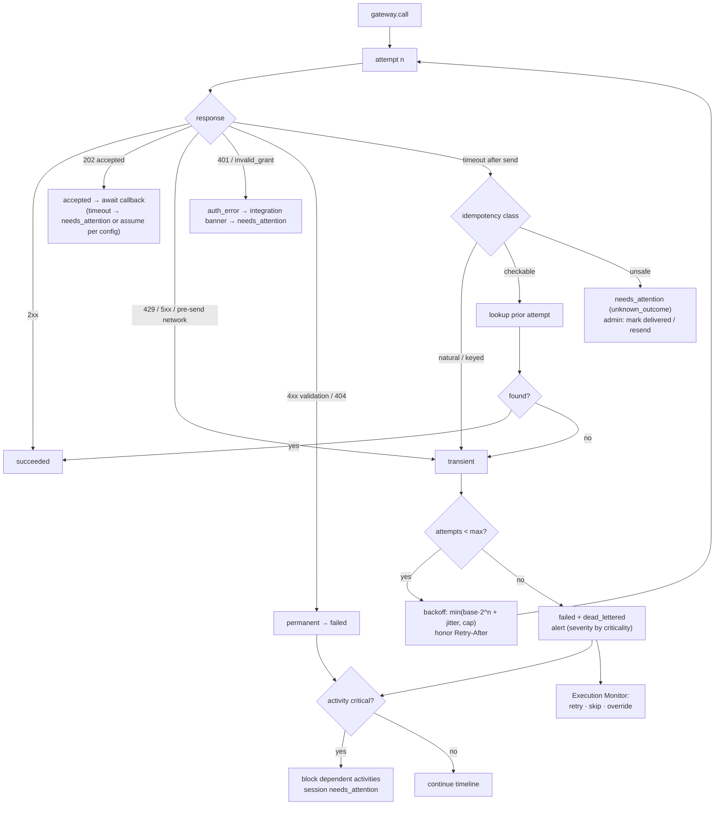

## 11. Workshop rescheduling

```mermaid
sequenceDiagram
  autonumber
  actor Ad as Admin
  participant A as api
  participant PG as PostgreSQL
  participant I as Inngest
  participant W as worker: reschedule workflow
  participant Z as Zoom
  participant G as Google Calendar
  participant C as Existing WA/Email
  Ad->>A: PATCH session 2 → 11:00 (If-Match v7)
  A->>A: preview impact (dry run): affected activities, external updates, notifications
  Ad->>A: confirm (reason, notify participants = yes)
  A->>PG: TX: update session, recompute anchored activities, generation++,<br/>cancel old runs, insert new runs, outbox (disarmed×N, armed×N, session.rescheduled), audit
  A-->>Ad: 200 (new plan)
  I->>I: cancelOn disarmed → old sleeping runs cancelled
  I->>W: session.rescheduled
  W->>Z: step PATCH /meetings/{id} start_time (counts toward 100/day/user limit)
  W->>G: step events.patch(deterministic id)
  W->>C: step trigger schedule_change (fan-out per registration)
  W->>PG: record all action executions
  Note over W: Zoom PATCH failure → session needs_attention,<br/>dependent "joining instructions" blocked; Calendar failure → retry queue only
```

## 12. Deployment architecture

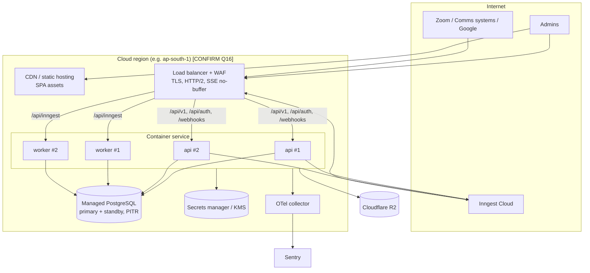

## 13. Sequence: registration

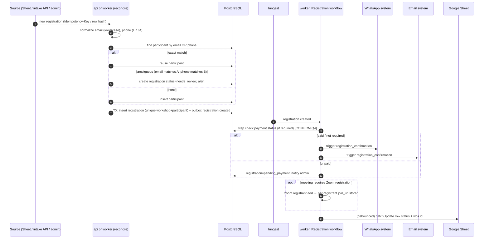

## 14. Sequence: workshop publish & activation

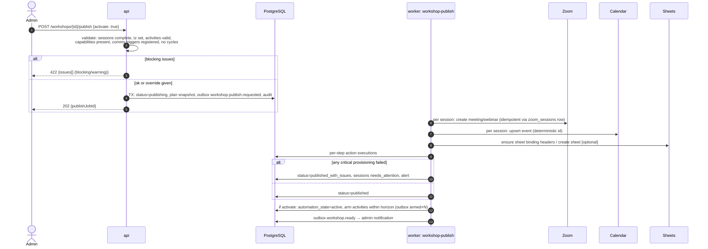

## 15. Sequence: Zoom session creation

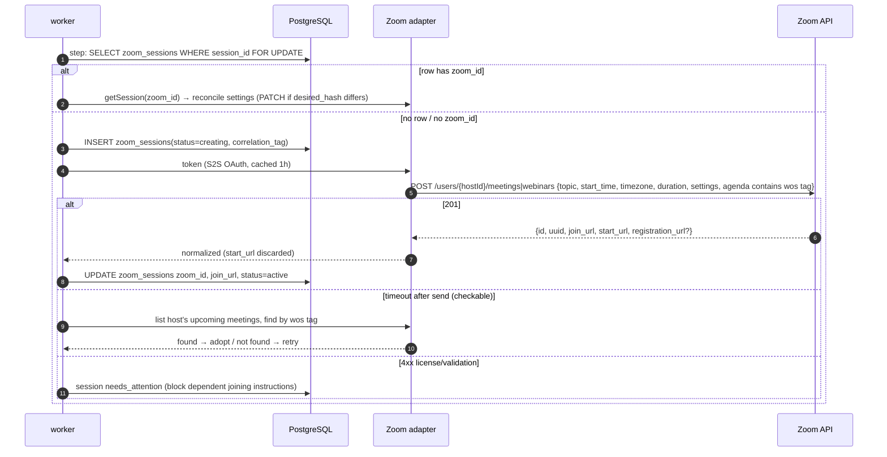

## 16. Sequence: attendance synchronization

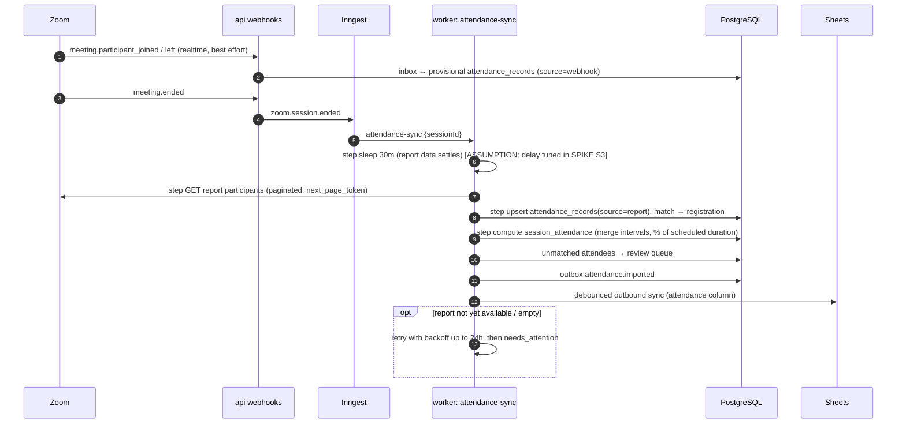

## 17. Sequence: workshop completion

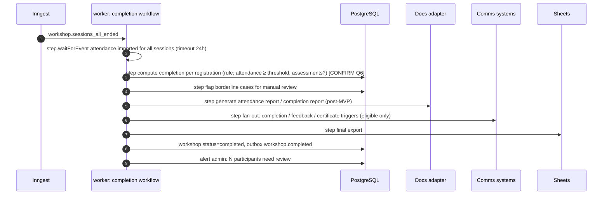

## 18. Execution state machine

Applies to `activity_runs`, `workflow_executions` and `action_executions`. Not every entity uses every state.

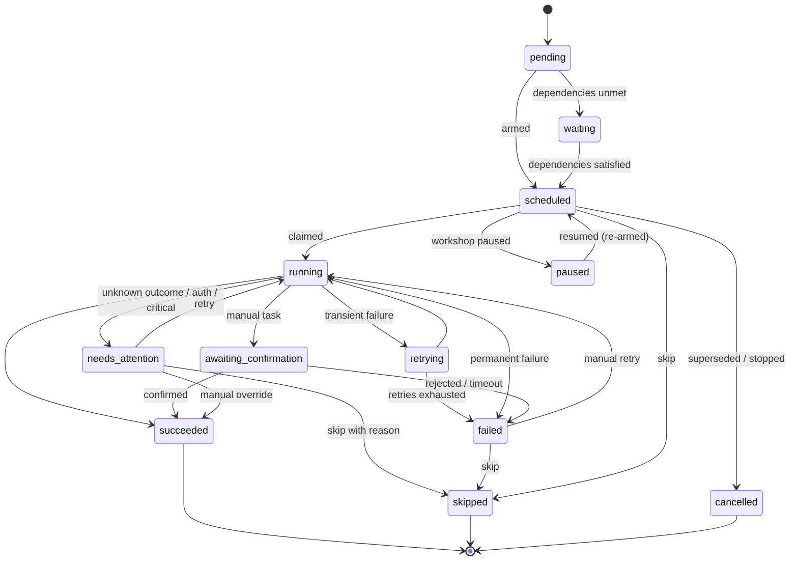
