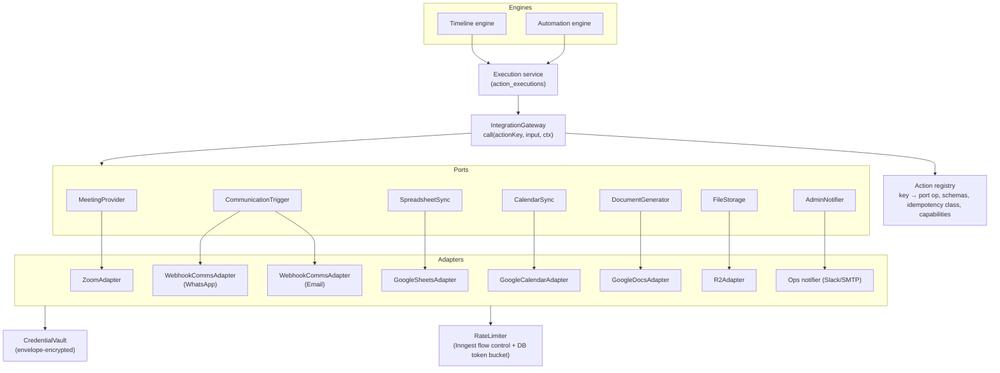

# Integration Architecture: Adapters, Ports and Provider Contracts

Related: [ADR-004](../adr/004-integration-adapter-pattern.md) · [ADR-012](../adr/012-unknown-outcome-no-auto-retry.md) · [whatsapp-email-integration.md](../features/whatsapp-email-integration.md) · [zoom-integration.md](../features/zoom-integration.md) · [google-workspace.md](../features/google-workspace.md) · [security.md](../engineering/security.md)

---

## 1. Purpose and scope

Provide one uniform way for the timeline and automation engines to cause effects in external systems and to receive their events. The layer must handle auth, rate limits, error classification, idempotency, recording and redaction, without leaking provider specifics into the engines.

## 2. User stories

- As an **admin**, I connect Zoom once (S2S OAuth credentials) and see which capabilities my license provides.
- As an **admin**, I register the existing WhatsApp system's triggers (`workshop_reminder`, …) so they appear as selectable actions in the timeline.
- As an **operator**, I see when an integration is degraded and which actions are affected.
- As an **engineer**, I add a new provider by implementing a port without touching the engines.

## 3. Architecture



### 3.1 Gateway call contract

```ts
// illustrative
interface IntegrationGateway {
  call<K extends ActionKey>(
    step: StepTools,                // Inngest step API; gateway wraps call in step.run
    key: K,                         // e.g. 'comms.trigger', 'zoom.webinar.create'
    input: ActionInput<K>,          // Zod-validated
    ctx: ExecutionContext,          // correlationId, workshopId, activityRunId|workflowExecutionId, target
  ): Promise<ActionResult<K>>;
}

type ActionResult<K> =
  | { status: 'succeeded'; output: ActionOutput<K>; externalRef?: string }
  | { status: 'accepted'; externalRef: string }            // async provider; completion via callback/webhook
  | { status: 'failed'; error: ClassifiedError }
  | { status: 'needs_attention'; reason: 'unknown_outcome' | 'auth' | 'capability_missing' | 'validation' };
```

Inside `call`:

1. Resolve the registry entry. Check capability flags against the integration's manifest (fail fast → `capability_missing`).
2. Compute the **idempotency key**: `sha256(actionKey + ':' + logical target + ':' + activityRunId|workflowStepExecutionId)`.
3. `INSERT action_executions … ON CONFLICT (idempotency_key) DO NOTHING RETURNING *`. If the row exists and is `succeeded`, return the stored result. This is the replay-safe path.
4. `step.run(stepId, async () => { insert action_attempts(started) → adapter op → update attempt(result) })`.
5. Classify errors (§5) and apply the idempotency-class retry rule ([ADR-012](../adr/012-unknown-outcome-no-auto-retry.md)).
6. Redact the request/response summary (§7) and persist it.

## 4. Ports (provider-independent interfaces)

| Port | Operations | Implementations |
|---|---|---|
| `MeetingProvider` | `createSession`, `updateSession`, `cancelSession`, `getSession`, `getJoinInfo`, `getHostStartUrl` (ephemeral), `endSession`, `addRegistrants`, `listRegistrants`, `fetchAttendance`, `listRecordings`, `capabilities()` | `ZoomAdapter` |
| `CommunicationTrigger` | `trigger(triggerKey, recipients[], variables, options)`, `bulkTrigger?`, `verifyCallback`, `capabilities()` | `WebhookCommsAdapter` (generic HTTP). Variants via config: n8n / Make / GoHighLevel / custom **[CONFIRM Q1]** |
| `SpreadsheetSync` | `readRange`, `batchUpdate`, `appendRows`, `getSheetMeta`, `capabilities()` | `GoogleSheetsAdapter` |
| `CalendarSync` | `upsertEvent(deterministicId, event)`, `cancelEvent`, `getEvent`, `freeBusy`, `capabilities()` | `GoogleCalendarAdapter` |
| `DocumentGenerator` | `generateFromTemplate(templateRef, data)`, `exportPdf`, `capabilities()` | `GoogleDocsAdapter` (Docs + Drive APIs) |
| `FileStorage` | `putObject`, `presignGet`, `presignPut`, `delete` | `R2Adapter` (S3-compatible API) |
| `AdminNotifier` | `notify(severity, message, links)` | In-app + Slack webhook / SMTP **[CONFIRM Q13]** |

## 5. Error classification

| Class | Typical sources | Retry? | Resulting state |
|---|---|---|---|
| `transient` | 5xx, 429, ECONNRESET **before** request body sent, DNS errors, Google `rateLimitExceeded` | Yes, exponential backoff with jitter. Honor `Retry-After` | `retrying` → `succeeded`/`failed` |
| `rate_limited_daily` | Zoom per-user daily 100 create/update limit **[VERIFIED]** | Retry after reset (00:00 UTC) or alert | `needs_attention` if deadline-critical |
| `auth` | 401, `invalid_grant`, revoked token, expired refresh token (Google Testing-mode 7-day expiry **[COMMUNITY]**) | No. Mark integration `auth_error` | `needs_attention`, integration banner |
| `permanent` | 400 validation, 404 resource gone, capability missing (e.g. webinar license) | No | `failed` |
| `unknown_outcome` | Timeout/connection reset **after** request sent | Only if idempotency class ∈ {natural, keyed, checkable} | `needs_attention` otherwise |
| `conflict` | 409 (e.g. Calendar event ID exists) | Resolve by read + patch | `succeeded` |

## 6. Rate limiting and flow control

Layered approach:

1. **Inngest flow control** on functions that call providers:
   - `throttle` keyed by `integrationId`, e.g. comms triggers 20/s (to be agreed with the client's system **[CONFIRM Q1]**).
   - `concurrency` keyed by `sheetBindingId` = 1. Zoom keyed by account = 5.
2. **Adapter-level token bucket** stored in Postgres (`integration_rate_buckets`) for limits that span functions, e.g. Google Sheets 60 writes/min/user **[VERIFIED]**. The bucket update is a single atomic `UPDATE … RETURNING`. This is coarse but correct.
3. **Provider budget awareness**: the Zoom adapter tracks the per-host daily create/update count and refuses non-critical updates near the limit (reserve 20 for emergencies).
4. **Circuit breaker**: if 5 consecutive `transient` failures happen within 2 min, the integration status becomes `degraded`. New calls short-circuit to `retrying` with a delay of 1–5 min. A probe call every minute closes the breaker. State is stored in `integrations.health_state`.

## 7. Recording and redaction

- `action_attempts.request_summary` and `.response_summary` hold **redacted JSON**: secrets removed, emails masked as `r***@d***.com`, and phones masked to their last 3 digits. The raw body is never stored.
- Full payloads are reconstructable from Postgres (inputs are IDs plus versioned config), which avoids storing PII twice.
- `external_ref` (Zoom meeting ID, comms execution ID, Calendar event ID) is always stored in clear text for support lookups.

## 8. Credentials and OAuth lifecycle

| Provider | Auth model | Refresh | Storage |
|---|---|---|---|
| Zoom | **Server-to-Server OAuth** (`account_credentials` grant). Token lifetime 1 h, no refresh token; request a new one **[VERIFIED by Zoom docs, re-check scopes in SPIKE S3]** | Fetch new token on expiry. Cache in memory per process + DB (encrypted) with `expires_at` | `integration_credentials` (account_id, client_id, client_secret, webhook secret token) |
| Google | OAuth 2.0 **user consent** (offline access, refresh token) **or** service account with domain-wide delegation (Workspace only) **[CONFIRM Q8]** | Refresh access token on 401/expiry. Detect `invalid_grant` → `auth_error` | refresh token encrypted |
| Comms systems | Shared HMAC secret and/or API key / bearer **[CONFIRM Q1]** | Manual rotation with dual-secret window | encrypted |
| R2 | Access key ID + secret (S3 API) | Manual rotation | env/secret manager (not DB) |

Token refresh concurrency: `SELECT … FOR UPDATE` on the credential row during refresh, so two workers never refresh the same Google token concurrently. For Zoom, this avoids burning token requests.

## 9. Capability registry and verification

Each adapter's `capabilities()` is computed by **probing**, not assumed:

| Capability | Probe |
|---|---|
| `zoom.webinars` | `GET /users/me/settings` (feature flags) or attempt to `GET /users/{id}/webinars` → 200 vs license error **[SPIKE S3]** |
| `zoom.reports` | `GET /report/...` minimal call → 200 vs 4xx (paid plan required **[COMMUNITY]**) |
| `zoom.simuliveApi` | **Always `false`** until Zoom documents an API to create/configure Simulive (see [zoom-integration.md §4](../features/zoom-integration.md#4-simulive-what-is-and-isnt-possible)) |
| `google.sheets.write` | Granted scopes include `spreadsheets` or `drive.file` |
| `comms.idempotencyKey` | Contract test: send the same key twice to a test trigger and check that it's deduped **[CONFIRM Q2]** |
| `comms.bulk` | Declared by client config, validated by a test call |

The timeline builder and publish validator consume the manifest. Activities requiring a missing capability can't be published without an explicit override.

## 10. Error scenarios and recovery

| Scenario | Behavior |
|---|---|
| Provider outage (5xx for 30 min) | Breaker opens. Actions wait in `retrying`. Unrelated activities continue. Alert after 10 min |
| Credentials revoked | Integration `auth_error`. All pending actions for that provider → `needs_attention`. Banner with "Reconnect" |
| Capability lost (license downgraded) | Next health check updates the manifest. Affected future activities flagged `blocked_capability` |
| Adapter bug (schema mismatch on response) | `permanent` failure with `response_schema_mismatch`. Sentry alert |

## 11. Testing requirements

- **Contract tests** per adapter: recorded fixtures (MSW) for success, 4xx, 5xx, 429 and timeouts. Output Zod schemas validate real recorded responses.
- **Live smoke tests** (nightly, staging) against a dedicated Zoom test account, a Google test project, and the comms systems' **test triggers** **[CONFIRM Q2]**.
- Gateway unit tests for idempotency (replay returns the stored result) and classification.

## 12. Acceptance criteria

- No module other than adapters imports provider SDKs/HTTP clients (lint-enforced).
- Every adapter call produces an `action_executions` row and ≥1 `action_attempts` row.
- A capability missing at publish time blocks publish unless an override is given (audited).
- Credentials are never logged, and never returned by any API after being saved.

## 13. Future improvements

- Additional comms adapters with native APIs (e.g. GoHighLevel workflow API) once Q1 is answered.
- Provider sandbox/replay mode for training admins.
- Per-integration SLO dashboards.
