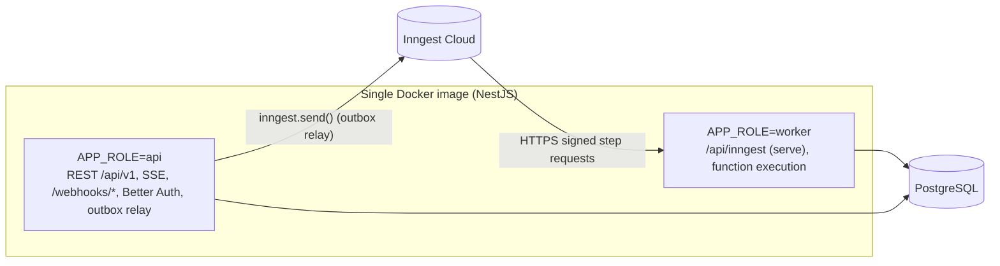
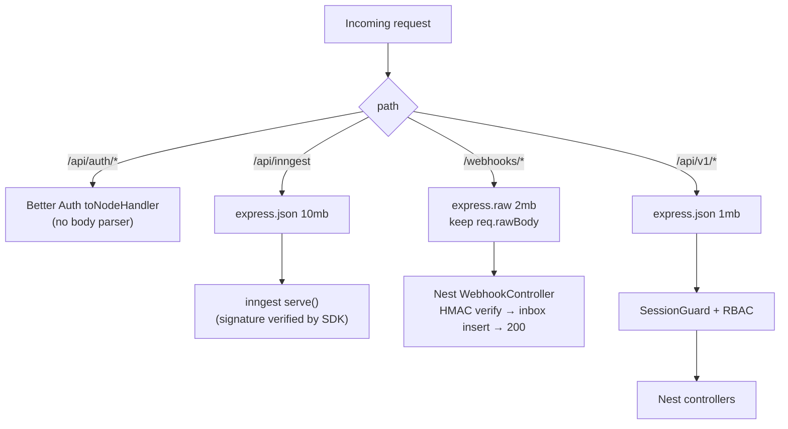

# Running Inngest inside NestJS: investigation and design

> **Why this document exists.** The PRD's reference architecture used Next.js API routes. Inngest's most visible examples are Next.js-first (`inngest/next`, Vercel deployment, serverless `maxRuntime` tuning). **None of that transfers unchanged to a NestJS application.** This document records what is officially supported, what isn't, the compatibility traps we found, and the exact integration design. Decision record: [ADR-005](../adr/005-nestjs-inngest-express-serve.md).

Related: [ADR-002](../adr/002-inngest-orchestration.md) (why Inngest), [ADR-006](../adr/006-auth-better-auth-and-body-parsing.md) (body parsing), [system-architecture.md](system-architecture.md).

---

## 1. What is officially supported (verified November 2026)

| Fact | Status | Source |
|---|---|---|
| Inngest's serving guide lists **NestJS → `inngest/express`**. There is no `inngest/nest` adapter | **[VERIFIED]** | [Serving Inngest functions](https://www.inngest.com/docs/learn/serving-inngest-functions) |
| Documented NestJS pattern: in `main.ts`, create the app, get services from the container (`app.get(...)`), build functions with a factory, and `app.use('/api/inngest', serve({ client, functions }))` | **[VERIFIED]** | same |
| Express needs `express.json()` before `serve()`, or "functions won't be executed" | **[VERIFIED]** | same |
| Raise the body limit: default 100 kb is too small; allow **≥ 4 MB** (the NestJS example uses 10 MB) | **[VERIFIED]** | same |
| `streaming: true` is supported on Express for longer requests | **[VERIFIED]** | same |
| Custom frameworks can build a handler on `InngestCommHandler` | **[VERIFIED]** | same |
| SDK **v4** released March 2026. Triggers move into `createFunction({ triggers })`. `EventSchemas` was replaced by `eventType()`. `signingKey`/`baseUrl` moved to the client. Default mode is `cloud` (dev needs `INNGEST_DEV=1`). Checkpointing and optimized parallelism are on by default | **[VERIFIED]** | [v3→v4 migration](https://www.inngest.com/docs/reference/typescript/v4/migrations/v3-to-v4) |
| v4 DI uses **class-based middleware** (`Middleware.BaseMiddleware`, `transformFunctionInput`). The v3 `dependencyInjectionMiddleware()` does not apply to v4 | **[VERIFIED]** | [Dependency injection](https://www.inngest.com/docs/durable-execution/guides-and-advanced/middleware/dependency-injection) |
| **Connect** mode: outbound WebSocket worker, no inbound HTTP endpoint. Needs Node ≥ 22.4 for TS, long-running hosts only, supports self-hosted (gateway port 8289), `maxWorkerConcurrency`, graceful SIGTERM drain | **[VERIFIED]** | [Connect](https://www.inngest.com/docs/setup/connect) |
| Connect described as **Public Beta**; "fine-grained migration from serve apps to connect" still in progress | **[COMMUNITY]/[VERIFIED partial]** | same / search snippets |
| Community NestJS wrappers exist: `nestjs-inngest`, `@torixtv/nestjs-inngest`, `nest-inngest` | **[COMMUNITY]**, unofficial | npm / pkgstats |

### What is **not** documented and must be proven by SPIKE S1

- `inngest/express` compatibility with **Express 5**, the default in NestJS 11. The docs don't mention an Express major. **[SPIKE]**
- Signature verification behavior when the parsed JSON body is re-serialized vs the raw body. **[SPIKE]** Our pipeline gives Inngest a standard `express.json()` body, exactly as documented, so we stay on the documented path.
- `@inngest/test` support for v4. **[SPIKE]**
- The exact sync mechanism in v4 (PUT to the serve endpoint, CLI, or dashboard) for CI. **[SPIKE]**

## 2. Why the Next.js integration does not carry over

| Next.js assumption | NestJS reality | Our handling |
|---|---|---|
| `export const { GET, POST, PUT } = serve(...)` from `inngest/next` in a route file | Nest has no file-based route handlers. Controllers are classes with decorators, and the Inngest handler needs raw `(req, res)` | Mount `inngest/express` as Express middleware in `main.ts` |
| Functions defined at module scope with global imports (`import { db } from '@/lib/db'`) | Services live in the DI container. Module-scope singletons bypass Nest lifecycle (config, shutdown hooks, testing overrides) | Function **factories** inside Nest providers. Dependencies captured by closure after DI resolves |
| Body parsing is automatic | Nest's global body parser must be **disabled** for Better Auth (ADR-006), and Inngest needs a large JSON limit | Route-scoped parsers in a single, tested pipeline |
| Serverless timeouts (10–60 s) → `checkpointing.maxRuntime` | Long-lived containers. The real limit is the **load balancer/proxy idle timeout** | Keep steps short (< 30 s). Set LB idle timeout ≥ 120 s on the worker. Enable `streaming: true` only after SPIKE S1 confirms LB behavior |
| Vercel integration auto-syncs functions on deploy | No such integration | CI post-deploy sync step |
| Middleware/auth via `middleware.ts` | Nest guards/interceptors/filters **do not apply** to raw Express middleware mounted with `app.use` | Intentional: Inngest's own request signing protects the endpoint. Never place it behind `SessionGuard` |
| Global error boundary via Next | Nest exception filters don't wrap the Inngest handler | Error capture via Inngest middleware → Sentry, plus `onFailure` handlers |

## 3. Integration design

### 3.1 Process roles



- The `api` role **sends** events only. It never serves functions, so admin latency is isolated from slow provider calls.
- The `worker` role **serves** functions. It may also send events (`step.sendEvent`).
- `APP_ROLE=all` is used for local dev and is acceptable for the first production release if traffic is low.

### 3.2 Module layout

```
src/
  bootstrap/
    main.ts                 # NestFactory.create(AppModule, { bodyParser: false }); builds pipeline
    http-pipeline.ts        # ordered parsers + mounts (ADR-006) — unit-tested
  platform/inngest/
    inngest.module.ts       # @Global; provides INNGEST_CLIENT, InngestRegistry
    inngest.client.ts       # new Inngest({ id: 'workshop-os', middleware: [...], logger })
    inngest.registry.ts     # DiscoveryService scan for @InngestFunctions() providers
    events.ts               # eventType() definitions (single catalog, Zod schemas)
    middleware/
      tracing.middleware.ts     # OTel context + run/step attributes
      error-capture.middleware.ts # Sentry with runId/fnId tags
      execution-log.middleware.ts # (optional) step lifecycle → logs
  modules/
    timeline/timeline.functions.ts      # @InngestFunctions() class → returns createFunction(...)[]
    automation/automation.functions.ts
    integrations/zoom/zoom.functions.ts
    integrations/google-sheets/sheets.functions.ts
    ...
```

### 3.3 Function factory pattern (illustrative)

```ts
// modules/timeline/timeline.functions.ts — illustrative, not final code
@InngestFunctions()
@Injectable()
export class TimelineFunctions {
  constructor(
    @Inject(INNGEST_CLIENT) private readonly inngest: Inngest,
    private readonly runs: ActivityRunService,       // singleton providers only
    private readonly executor: ActivityExecutor,
  ) {}

  build() {
    const executeActivity = this.inngest.createFunction(
      {
        id: 'timeline-activity-execute',            // never rename once deployed
        triggers: [{ event: activityArmed }],        // v4: triggers inside options
        idempotency: 'event.data.runId',
        cancelOn: [{ event: activityDisarmed,
          if: 'async.data.activityId == event.data.activityId && async.data.generation >= event.data.generation' }],
        concurrency: [{ key: 'event.data.workshopId', limit: 10 }],
        retries: 4,                                  // for unexpected errors only; provider attempts return
                                                     // classified outcomes and use our own attempt loop (ADR-013)
      },
      async ({ event, step }) => {
        await step.sleepUntil('wait-until-due', event.data.scheduledFor);
        const claim = await step.run('claim', () => this.runs.claim(event.data.runId));
        if (!claim.ok) return { skipped: claim.reason };           // fenced: stale/paused/duplicate
        return this.executor.execute(step, claim.run);              // adapters called inside step.run
      },
    );
    return [executeActivity];
  }
}
```

```ts
// bootstrap/main.ts — illustrative
const app = await NestFactory.create(AppModule, { bodyParser: false });
buildHttpPipeline(app, { role: env.APP_ROLE });      // ADR-006 order
if (env.APP_ROLE !== 'api') {
  const registry = app.get(InngestRegistry);
  app.use('/api/inngest', express.json({ limit: '10mb' }),
          serve({ client: app.get(INNGEST_CLIENT), functions: registry.all() }));
}
app.enableShutdownHooks();
await app.listen(env.PORT);
```

### 3.4 Discovery rules

- `InngestRegistry` scans providers via `DiscoveryService` **once at bootstrap**. Functions cannot be registered dynamically after `serve()` is mounted.
- Duplicate function IDs fail fast at boot.
- Each registered function ID is listed in a CI snapshot (`inngest-functions.snapshot.json`). **Removing or renaming** an ID requires a migration note, because in-flight runs of the removed function will fail.

### 3.5 Dependency scope rules

| Allowed in Inngest functions | Forbidden |
|---|---|
| `@Injectable()` singletons (default scope) | `Scope.REQUEST` / `Scope.TRANSIENT` providers (no HTTP request context exists) |
| Drizzle `db` provider, adapters, domain services | `@Req()`, `REQUEST` token, `ClsService` request context **unless** set up by our middleware per run |
| Config via `ConfigService` | Mutable module-level state |

Per-run context (runId, workshopId, correlationId, actor = `system:inngest`) is created by **tracing middleware** in `transformFunctionInput`. It is passed explicitly to domain services as a `ExecutionContext` value object. It is never read from an ambient request.

## 4. HTTP pipeline (body parsing)

See [ADR-006](../adr/006-auth-better-auth-and-body-parsing.md) for the full table. Summary:



## 5. Execution model: replay semantics

Inngest executes a function by calling the serve endpoint repeatedly. Completed steps are **memoized**: their results are returned from state instead of re-running. Code **between** steps re-executes on each invocation. In v4 with checkpointing, several steps may run in one request, but the replay rule still holds.

Rules enforced by code review and lint:

1. **All side effects and all non-determinism inside `step.run`**: DB reads/writes, HTTP calls, `Date.now()`, `crypto.randomUUID()`, `Math.random()`.
2. Step IDs are **stable strings**: `"claim"`, `` `action:${nodeId}` ``, `` `notify:${participantId}` ``. They are never derived from loop indexes over mutable lists.
3. Step return values are **small** (IDs, statuses). The step return limit is 4 MiB and run state is 32 MiB **[VERIFIED]**. Large data (participant lists) is read from Postgres inside each step that needs it, or fanned out as events.
4. **≤ 1,000 steps per run** **[VERIFIED]**. Per-participant work fans out with `step.sendEvent` (≤ 5,000 events per call **[VERIFIED]**) to a child function. One run never loops over all participants.
5. Treat each step as **at-least-once**: it may run, fail to report, and run again. Every external call carries an idempotency key, or follows [ADR-012](../adr/012-unknown-outcome-no-auto-retry.md).
6. Throw `NonRetriableError` for permanent failures. Throw `RetryAfterError` when the provider returns `Retry-After` **[ASSUMPTION: both still exported in v4; verify in SPIKE S1]**.

## 6. Retries and execution records

- Inngest retries are **per step** (function `retries` 0–20, default 4) **[VERIFIED]**.
- We want one `action_executions` row per **logical action** and one `action_attempts` row per attempt. The adapter wrapper (`IntegrationGateway.call`) writes the attempt row **inside the same `step.run`** before and after the HTTP call. Retries therefore create additional attempt rows naturally. There's no reliance on middleware hooks for the authoritative record.
- `onFailure` handlers mark the activity run / workflow execution `failed` or `needs_attention` and raise an alert ([execution-monitoring.md](../features/execution-monitoring.md)).

## 7. Local development

- `INNGEST_DEV=1` and the Inngest Dev Server (`npx inngest-cli@<pinned> dev -u http://localhost:3000/api/inngest`) **[VERIFIED: dev server & env var; exact CLI flags to be pinned in SPIKE S1]**.
- `docker compose` runs `postgres`, `inngest-dev`, `server (APP_ROLE=all)`, `web`.
- No signing key is needed in dev mode. In cloud mode the SDK requires a signing key **[VERIFIED]**.

## 8. Deployment and sync

1. Deploy the worker image.
2. Health check passes (`/healthz` on worker, which includes DB connectivity).
3. CI triggers an **app sync** so Inngest Cloud learns new or changed functions **[SPIKE: confirm v4 mechanism]**.
4. Separate Inngest **environments** for staging and production, each with its own event key and signing key. Use `signingKeyFallback` during key rotation **[VERIFIED: option exists on client in v4]**.

Rolling deploys: during a rollout, old and new workers may both receive step requests. Function code must be **backward compatible for in-flight runs**: no step-ID renames, and no changes to the meaning of memoized step outputs. A breaking change ships as a **new function ID** (`timeline-activity-execute-v2`). The old one is drained and then removed.

## 9. Connect mode (future option)

| | Serve (chosen) | Connect |
|---|---|---|
| Inbound public endpoint | Required on worker | Not required (outbound WS) |
| Long steps | Bounded by LB/proxy timeouts | No HTTP timeout per step |
| Maturity | GA, documented for NestJS via Express | Public Beta **[COMMUNITY]**; migration from serve apps limited |
| Runtime | Any Node LTS | Node ≥ 22.4 |
| Serverless | Possible | Not supported |

Re-evaluate Connect in **Phase 6** if the worker's public endpoint becomes a security concern or if long-running steps are needed.

## 10. Risks specific to this integration

| Risk | Likelihood | Mitigation |
|---|---|---|
| Express 5 incompatibility in `inngest/express` | Low–Med | SPIKE S1. Fallback: pin NestJS to Express 4 adapter, or use `InngestCommHandler` custom handler |
| Body parser misordering breaks auth or Inngest signature | Med | Single pipeline module + integration test that hits all four route families |
| Breaking SDK changes (v4 → v5) | Med (over years) | Pin exact versions. Wrap SDK in `platform/inngest` so call sites change in one place |
| Non-deterministic code outside steps | Med | Lint rule (custom ESLint) forbidding `Date.now`/`fetch`/`db.` at function top-level. Code review checklist |
| Inngest endpoint exposed publicly | Low | Signed requests only. Path-specific WAF rate limits. Only the worker role exposes it |
| Inngest Cloud outage | Low | Postgres watchdog alerts. Manual execute-now (phase 2 degraded mode) |
