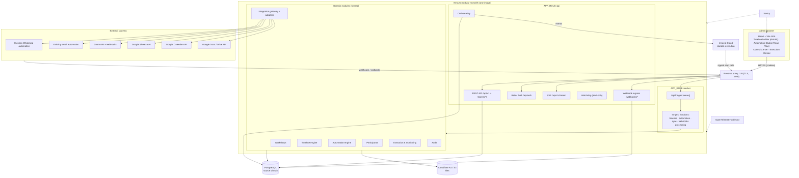
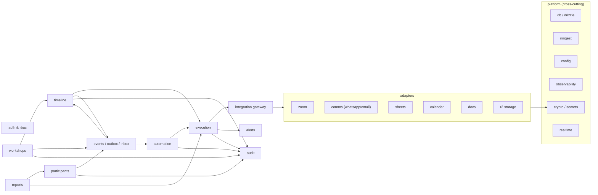

# System Architecture

Related: [data-flow.md](data-flow.md) · [diagrams.md](diagrams.md) · [nestjs-inngest-integration.md](nestjs-inngest-integration.md) · [integration-architecture.md](integration-architecture.md) · [technical-stack.md](../engineering/technical-stack.md)

---

## 1. Architectural goals (ranked)

1. **Reliability**: scheduled actions fire once, on time, and survive restarts. Failures are visible and recoverable.
2. **Isolation of failures**: one failed integration doesn't block unrelated activities (PRD §6.4, §8).
3. **Auditability and reproducibility**: every action has an execution record, and published workflow versions are immutable.
4. **Operability**: admins can pause, resume, retry, skip, override and reschedule live.
5. **Provider independence**: the timeline and workflow engines know nothing about Zoom or Google specifics.
6. **Simplicity**: one deployable, no microservices, no Redis unless forced.

## 2. High-level architecture



## 3. The five engines from the PRD, mapped to modules

| PRD component | Module(s) | Responsibility | Owns tables |
|---|---|---|---|
| 01 Workshop Timeline Engine | `timeline` | Plan model (activities, anchors, dependencies), schedule computation, arming, rescheduling | `timeline_activities`, `activity_dependencies`, `activity_runs` |
| 02 Event & Trigger Engine | `events` (+ `webhooks`) | Domain event catalog, outbox, webhook inbox, normalization of external events into internal events | `outbox_events`, `webhook_events`, `domain_event_log` |
| 03 Workflow Orchestrator | `automation` | Workflow definitions, versions, interpreter, conditions, branching | `automation_workflows`, `workflow_versions`, `workflow_executions`, `workflow_step_executions` |
| 04 Integration Adapter Layer | `integrations/*` | Ports, adapters, credentials, rate limits, capability manifests | `integrations`, `integration_credentials`, `communication_triggers`, `external_links`, `sheet_bindings`… |
| 05 Execution & Monitoring Engine | `execution`, `alerts`, `audit` | Action executions & attempts, retries, DLQ, alerts, overrides, audit | `action_executions`, `action_attempts`, `alerts`, `audit_logs` |

**Key distinction (from the PRD):** the timeline defines *what should happen*, and the orchestration engine *makes it happen*. In code, `timeline` never calls adapters directly. It asks `execution` to run an **action** through the `IntegrationGateway`.

## 4. Backend module map



Dependency rules (enforced by lint):

- Domain modules may depend on `platform/*` and on other modules' **public service interfaces** (`index.ts` exports), never on their repositories or tables.
- Adapters depend only on `platform/*` and `integration gateway` contracts.
- Cycles are forbidden. `events` is the decoupling point: `timeline` reacts to `participants` events via the outbox, not via direct calls.

## 5. Low-level architecture: request paths

### 5.1 Admin command (e.g. "Reschedule session 2 to 11:00")

1. SPA → `PATCH /api/v1/sessions/{id}/schedule` with `If-Match: <version>` and `Idempotency-Key`.
2. `SessionGuard` → `RbacGuard(permission: timeline.reschedule)` → Zod validation pipe.
3. `WorkshopsService.rescheduleSession()` inside **one DB transaction**:
   - Optimistic lock check on `sessions.version`.
   - Update session times, recompute anchored activity times (`TimelinePlanner`), and bump `schedule_generation` on affected activities.
   - Insert `activity_runs` for re-armed activities. Mark old runs `cancelled (superseded)`.
   - Insert outbox events: `session.rescheduled`, `activity.disarmed` ×N, `activity.armed` ×N.
   - Insert `audit_logs` with before/after.
4. Commit → `pg_notify` → SSE update to all viewers.
5. Outbox relay sends events to Inngest (immediate attempt after commit, sweeper fallback).
6. Inngest functions: `session.rescheduled` triggers the **reschedule workflow** (Zoom PATCH, Calendar patch, comms triggers). Each action is recorded.

### 5.2 Scheduled activity execution

See [timeline-engine.md §7](../features/timeline-engine.md#7-execution-algorithm) and the sequence in [diagrams.md](diagrams.md#6-reminder-execution-sequence).

### 5.3 Inbound webhook (e.g. Zoom `meeting.ended`)

1. `POST /webhooks/zoom` → raw body → verify `x-zm-signature` + timestamp window.
2. Insert into `webhook_events` (unique `dedupe_key`). On conflict → 200 (duplicate).
3. Insert outbox `webhook.received {webhookEventId}` in the same transaction. Respond **200 within 3 s** (Zoom requirement **[VERIFIED]**).
4. Inngest `webhooks/process` normalizes it into an internal domain event `zoom.session.ended {sessionId}`. That event may complete `event`-mode activities and trigger workflows.

## 6. Process topology and scaling

| Role | Instances (MVP) | Scales on | Notes |
|---|---|---|---|
| `api` | 2 (HA) | CPU, open SSE connections | Stateless. SSE fan-out via Postgres NOTIFY |
| `worker` | 2 | Inngest step concurrency, provider latency | Stateless. Inngest balances step calls |
| PostgreSQL | 1 primary (+ standby for HA) | Connections, IO | Managed service with PITR |
| Inngest | SaaS | Plan limits | Pro plan or higher for production **[LICENSE]** |

The workloads are small: 10 concurrent workshops × 500 participants × ~20 comms activities is roughly 100k action executions per month. That is far below what a single Postgres instance and a couple of containers handle. Scaling concerns are mostly **provider rate limits**, not our compute. See [reliability-patterns.md §10](../engineering/reliability-patterns.md#10-external-api-rate-limits-and-outages).

## 7. Cross-cutting concerns

| Concern | Approach | Doc |
|---|---|---|
| Idempotency | Unique keys at every boundary (API, events, actions, external writes) | [reliability-patterns.md](../engineering/reliability-patterns.md#3-idempotency-and-duplicate-prevention) |
| Concurrency control | Optimistic locking (`version` columns), conditional-update claims, Postgres advisory locks for rare global sections | [reliability-patterns.md](../engineering/reliability-patterns.md#17-race-conditions-and-distributed-locking) |
| Time | All instants `timestamptz` UTC. Workshop IANA timezone. Wall-clock times stored with their zone | [reliability-patterns.md](../engineering/reliability-patterns.md#1-reliable-scheduled-execution-and-timezone-handling) |
| Security | RBAC, encrypted credentials, signed webhooks, audit | [security.md](../engineering/security.md) |
| Observability | OTel traces (API → outbox → Inngest step → adapter HTTP). Sentry errors. Execution tables as the business-level log | [execution-monitoring.md](../features/execution-monitoring.md) |

## 8. Repository layout (proposed)

```
/
├── apps/
│   ├── server/          NestJS (all roles)
│   └── web/             React + Vite SPA
├── packages/
│   ├── contracts/       Zod schemas: API DTOs, event payloads, workflow DSL, action configs
│   ├── ui/              shadcn/ui components (generated into repo)
│   └── config/          eslint, tsconfig, vitest presets
├── docs/                this documentation
├── infra/               Docker, compose, IaC
└── pnpm-workspace.yaml  (pnpm + Turborepo)
```

## 9. What is deliberately **not** in the architecture

- **No Redis** in the MVP. Locks use Postgres, rate limiting uses Inngest flow control plus an in-DB token bucket for API-level limits, realtime uses `LISTEN/NOTIFY`, and caching isn't needed. Self-hosting Inngest would bring Redis back ([ADR-002](../adr/002-inngest-orchestration.md)).
- **No message broker** (Kafka/RabbitMQ). Inngest plus the outbox covers async needs.
- **No GraphQL/tRPC.** REST + OpenAPI is required by the brief and by external callers.
- **No multi-tenancy columns** (`tenant_id`). Single business. If multi-tenancy ever appears, it would need a new ADR and a schema migration.
