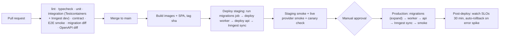

# Deployment and Infrastructure

Related: [system-architecture.md §6](../architecture/system-architecture.md#6-process-topology-and-scaling) · [nestjs-inngest-integration.md §8](../architecture/nestjs-inngest-integration.md#8-deployment-and-sync) · [diagrams.md §12](../architecture/diagrams.md#12-deployment-architecture) · [security.md](security.md)

---

## 1. Environments

| Env | Purpose | Inngest | Providers | Data |
|---|---|---|---|---|
| **local** | Development | Inngest Dev Server (`INNGEST_DEV=1`) | MSW mocks by default. Optional personal test accounts | Seed data |
| **preview** (optional) | Per-PR ephemeral | Inngest branch environment **[VERIFIED: branch deploys exist; count limits per plan]** | Mocks | Seed |
| **staging** | Integration, UAT, canary workshop | Inngest Cloud staging env (own keys) | Dedicated Zoom test account, Google test project, comms test triggers | Synthetic + anonymized |
| **production** | Live | Inngest Cloud production env (Pro plan or higher **[LICENSE]**) | Client accounts | Live |

## 2. Container images

- One multi-stage Dockerfile for `apps/server` (all roles): `node:<LTS>-slim` build → `gcr.io/distroless/nodejs` (or slim) runtime, non-root, `NODE_ENV=production`, `--enable-source-maps`.
- `apps/web` builds static assets → deployed to CDN/static hosting (or served by the reverse proxy on the same domain, which is required for same-site cookies, [ADR-006](../adr/006-auth-better-auth-and-body-parsing.md)).
- Image tags are immutable (`git sha`). The same image is promoted from staging to production.

## 3. Runtime configuration

| Variable | Notes |
|---|---|
| `APP_ROLE` | `api` / `worker` / `all` |
| `DATABASE_URL`, `DATABASE_POOL_MAX` | Pool per role (api 10, worker 10). A direct (non-PgBouncer) URL is used for `LISTEN` |
| `INNGEST_SIGNING_KEY`, `INNGEST_SIGNING_KEY_FALLBACK`, `INNGEST_EVENT_KEY` | Per environment |
| `INNGEST_SERVE_ORIGIN` | Public origin of the worker if behind a proxy (v4 renamed from `serveHost` **[VERIFIED]**) |
| `BETTER_AUTH_SECRET`, `BETTER_AUTH_URL`, `TRUSTED_ORIGINS` | |
| `KMS_KEY_ID` / `WOS_MASTER_KEY` (dev only) | Credential envelope encryption |
| `R2_ACCOUNT_ID`, `R2_ACCESS_KEY_ID`, `R2_SECRET_ACCESS_KEY`, `R2_BUCKET` | |
| `OTEL_EXPORTER_OTLP_ENDPOINT`, `SENTRY_DSN` | |
| `ARMING_HORIZON_DAYS` (21), `SWEEPER_OVERDUE_SECONDS` (120), `WATCHDOG_ALERT_SECONDS` (300) | Engine tuning |

Config is validated at boot with Zod. The process exits on invalid config.

## 4. Reference hosting (proposed) [CONFIRM Q16, Q17]

Choose one cloud. Two viable options:

| Component | Option A: AWS (ap-south-1 Mumbai) | Option B: managed PaaS (Render/Railway/Fly.io) |
|---|---|---|
| Containers | ECS Fargate services `api` (2 tasks), `worker` (2 tasks) | 2 web services + 2 worker services (both HTTP) |
| Load balancer | ALB (HTTP/2, idle timeout ≥ 120 s for worker and SSE) + AWS WAF | Platform LB (verify SSE/no-buffer and timeouts) |
| Postgres | RDS PostgreSQL Multi-AZ, PITR 14 days | Managed Postgres with PITR (Neon/Render/Railway; verify PITR window) |
| Secrets/KMS | Secrets Manager + KMS | Platform secrets + app-level master key (weaker) |
| Static SPA | CloudFront + S3, or Cloudflare Pages behind same domain | Static site service |
| Files | Cloudflare R2 | Cloudflare R2 |
| Logs/traces | CloudWatch + OTel collector sidecar → backend | Platform logs + OTLP to SaaS backend |
| Fit | Stronger security/compliance, more ops | Faster setup, lower ops, fewer controls |

**Recommendation:** Option A if the client needs data-residency assurances and KMS-backed encryption. Option B for the fastest MVP, with a planned migration path (everything is containerized and config-driven).

Network rules: only the LB is public. The `/api/inngest` route is forwarded **only** to worker tasks. Workers and api reach Postgres over private networking. Outbound egress is open to provider APIs (optionally via a NAT with a static IP if the client's comms system allow-lists IPs **[CONFIRM Q1]**).

## 5. CI/CD (GitHub Actions)

- **Migrations** run as a one-off job before rollout and must be backward compatible (expand/contract).
- **Deploy order:** worker first (new function code can serve old events), then api (may emit new events), then sync Inngest functions **[SPIKE S1: confirm sync mechanism]**.
- **Deploy windows:** avoid deploying during live sessions. The pipeline checks for `in_progress` workshops with activities in the next 30 min and requires an override to proceed.
- **Rollback:** redeploy the previous image. DB migrations are forward-only, and the expand/contract discipline makes the previous image compatible.

## 6. Scaling

| Dimension | Approach |
|---|---|
| api | Horizontal (stateless). SSE fan-out via LISTEN/NOTIFY. Scale on CPU/connections |
| worker | Horizontal. Inngest distributes step requests. Bound by plan concurrency (Pro 100 concurrent steps **[VERIFIED]**) and provider throttles |
| Postgres | Vertical first. Read replica for reports (P2). PgBouncer/RDS Proxy if connections exceed ~100 |
| Partitioning | `action_attempts` monthly partitions at > 10 M rows |
| Provider limits | Throttles, daily budgets, staggering (see [reliability-patterns §10](reliability-patterns.md#10-external-api-rate-limits-and-outages)) |

Connection budget example: 2 api × 10 + 2 worker × 10 + 2 LISTEN + migrations/admin 5 = ~47 connections, which fits small instances.

## 7. Backups and disaster recovery

| Item | Policy (proposed) |
|---|---|
| Postgres | Managed automated backups + PITR (≥ 14 days). Daily logical dump (`pg_dump`, encrypted) to R2 with 90-day retention (cross-provider copy) |
| R2 files | Object versioning (if enabled) + lifecycle rules |
| Secrets | Stored in the secrets manager. KMS keys with deletion protection |
| Config/IaC | In git |
| **RPO** | ≤ 5 min (PITR) |
| **RTO** | ≤ 1 h (restore + redeploy) |
| Restore drills | Quarterly: restore to a scratch env, run integrity checks, measure RTO |

After a restore to a point in time, **Inngest state may be ahead of the DB**: runs may reference rows that no longer exist, or the DB may lack recent runs. Recovery procedure:

1. Put all workshops' automation in `paused`.
2. Run the reconciliation job to compare `activity_runs` with expected arming. Re-arm (generation++) everything future.
3. Review `action_executions` gaps against provider logs (comms, Zoom) for the lost window.
4. Resume.

## 8. Cost model

Rough monthly estimate for 10 workshops × 500 participants. To be validated against current pricing.

| Item | Driver | Estimate |
|---|---|---|
| Inngest | Executions: ~15 comms activities × 500 × 2 channels × ~3 steps ≈ 450k steps/month + crons (sweeper every minute ≈ 43k runs/month) | Within **Pro** included 1 M executions **[VERIFIED included amounts]**. Free plan (50k) insufficient. **Bulk comms triggers would cut this by ~10–100×** |
| Containers | 4 small tasks (0.5 vCPU / 1 GB) | Low |
| Postgres | Small Multi-AZ instance | Moderate (largest fixed cost) |
| R2 | Materials + exports (GBs). Recordings if copied (could be TBs) | Low unless recordings are copied **[CONFIRM Q10]** |
| Observability | Sentry + tracing backend | Plan-dependent |
| Zoom/Google | Client's existing licenses | — |
| WhatsApp messaging | Per-template-message charges in the client's existing system | Visible via trigger counts |

Cost levers: sweeper frequency (1 min → 2 min halves cron executions), bulk triggers, step consolidation for internal DB-only logic.

## 9. Operational readiness checklist (pre go-live)

- [ ] Inngest production plan confirmed. Keys rotated and stored. Function sync verified.
- [ ] Zoom S2S app scopes approved, webhook endpoint validated, event subscriptions set.
- [ ] Google OAuth app published (Internal or In production). Refresh token obtained by the ops account.
- [ ] Comms systems: triggers registered, verified, idempotency status known.
- [ ] Ops alert channel tested (critical alert drill).
- [ ] Backups + restore drill done. RTO measured.
- [ ] Runbooks written (Inngest outage, provider outage, DB failover, credential revocation, restore).
- [ ] Load test and chaos test reports reviewed.
- [ ] Pen test / security review complete.
- [ ] Canary workshop running in staging.
