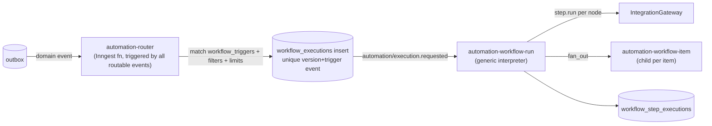

# Automation Engine (Automation Studio)

The timeline handles **time-anchored** workshop scheduling. The automation engine handles **event-driven, conditional** logic, for example "when registration closes → split paid/unpaid → confirm or alert → sync sheet". Execution is server-side and independent of the React Flow editor (PRD §4).

Related: [ADR-008](../adr/008-workflow-versioning.md) · [timeline-engine.md](timeline-engine.md) · [integration-architecture.md](../architecture/integration-architecture.md) · Diagram: [workflow execution](../architecture/diagrams.md#5-automation-workflow-execution)

---

## 1. Purpose and scope

- Define workflows as **directed acyclic graphs**: trigger → nodes (conditions, actions, delays, waits, fan-out, branches) → end.
- Version workflows immutably. Executions pin their version.
- Execute durably via a **generic interpreter** Inngest function. There's no code generation per workflow.
- Provide execution history at node level, with retry-from-node.

## 2. User stories

| # | Story |
|---|---|
| US-AE-1 | When registration closes for a workshop, fetch confirmed participants, branch on payment status: paid → trigger confirmation workflow; unpaid → notify admin. Then sync the sheet (PRD §4 example). |
| US-AE-2 | When attendance is imported, for participants with attendance < 75%, trigger the "missed session" email. |
| US-AE-3 | When a Zoom recording is ready, wait 30 minutes, publish it, and trigger the "recording available" WhatsApp. |
| US-AE-4 | I edit a published workflow. Running executions are unaffected. New triggers use the new version. |
| US-AE-5 | Step 7 of 10 failed. I retry from step 7 without re-running steps 1–6 (PRD §10). |
| US-AE-6 | I limit a workflow to at most 1 execution per participant per workshop ("has not received the reminder"). |

## 3. Functional requirements

FR-AE-01…09 ([product-requirements.md](../planning/product-requirements.md#53-automation-workflows-doc)).

## 4. Workflow DSL (persisted model)

Stored as JSON, validated by Zod (`@wos/contracts/workflow`). It is **not** React Flow's internal JSON.

```jsonc
{
  "schemaVersion": 1,
  "trigger": {
    "type": "event",                        // event | schedule | manual
    "event": "registration.closed",
    "filter": { "all": [{ "field": "event.workshopId", "op": "in_scope" }] }
  },
  "context": { "subject": "workshop" },     // workshop | registration | session
  "nodes": [
    { "id": "fetch", "type": "query", "query": "registrations", "params": { "status": ["confirmed","pending_payment"] }, "as": "regs" },
    { "id": "split", "type": "for_each", "items": "regs", "as": "reg", "mode": "fan_out", "maxItems": 5000 },
    { "id": "paid?", "type": "condition",
      "condition": { "all": [{ "field": "reg.paymentStatus", "op": "eq", "value": "paid" }] } },
    { "id": "confirm", "type": "action", "action": "comms.trigger",
      "config": { "integration": "whatsapp", "triggerKey": "payment_confirmation" },
      "onError": { "policy": "continue", "retry": { "maxAttempts": 3 } } },
    { "id": "alert", "type": "action", "action": "ops.notify", "config": { "template": "unpaid_review" } },
    { "id": "sync", "type": "action", "action": "sheets.sync", "config": { "binding": "workshop_default" } },
    { "id": "end", "type": "end" }
  ],
  "edges": [
    { "from": "fetch", "to": "split" },
    { "from": "split", "to": "paid?", "scope": "item" },
    { "from": "paid?", "to": "confirm", "when": "true" },
    { "from": "paid?", "to": "alert", "when": "false" },
    { "from": "split", "to": "sync", "scope": "after_all" },
    { "from": "sync", "to": "end" }
  ],
  "limits": { "maxConcurrentExecutions": 1, "dedupe": { "key": "trigger.workshopId", "window": "PT24H" } }
}
```

### 4.1 Node types

| Node | Semantics | Inngest mapping |
|---|---|---|
| `trigger` | Event/schedule/manual. Filter on event fields | Function trigger on `automation/execution.requested` (the router emits it, see §6) |
| `query` | Load entities from Postgres by safe, predefined queries (no raw SQL) | `step.run` returning **IDs only** |
| `condition` | Boolean over the condition AST → `true`/`false` edges | `step.run` (reads current data) |
| `switch` (P2) | Multi-way on a field value | `step.run` |
| `action` | Any registry action ([§7](#7-action-catalog)) | `gateway.call` → `step.run` |
| `delay` | Duration or until instant | `step.sleep` / `step.sleepUntil` |
| `wait_for_event` | Wait for an event matching an expression, with timeout → `timeout` edge | `step.waitForEvent` |
| `for_each` | Iterate items. `mode: inline` (≤ 50 items) or `fan_out` (child executions per item) | inline: steps with IDs `node:item:<id>`; fan_out: `step.sendEvent` |
| `manual_approval` | Wait for an operator decision (approve/reject edges) | `waitForEvent automation/approval.decided` |
| `run_workflow` | Invoke another workflow (sub-workflow) | `step.invoke` with function reference **[VERIFIED v4: string IDs removed; use function instance/reference]** |
| `end` | Terminal (`succeeded`) or `fail` terminal | — |

### 4.2 Condition language

A structured AST, not code:

```jsonc
{ "any": [
  { "all": [
    { "field": "registration.paymentStatus", "op": "eq", "value": "paid" },
    { "field": "registration.attendancePct", "op": "gte", "value": 75 }
  ]},
  { "field": "participant.tags", "op": "contains", "value": "vip" }
]}
```

- Operators: `eq, neq, in, nin, gt, gte, lt, lte, contains, exists, not_exists, between, before, after, within_last`.
- Fields come from a **typed field catalog** per subject (workshop, session, registration, participant, execution history). Examples:
  - `history.actionSucceeded(triggerKey='workshop_reminder', scope='this_workshop')`, which covers "participant has not received the reminder"
  - `workshop.isActive`
  - `session.status`
- Evaluated by a small interpreter (~200 LOC) with exhaustive tests. JSONLogic was considered but rejected: it's less typed and harder to validate in the editor.
- PRD example conditions are all expressible:

| PRD condition | AST |
|---|---|
| Payment status equals paid | `registration.paymentStatus eq paid` |
| Participant belongs to workshop X | `registration.workshopId eq wks_X` |
| Attendance > 75% | `registration.attendancePct gt 75` |
| Session status equals completed | `session.status eq ended` |
| Workshop is currently active | `workshop.automationState eq active` |
| Participant has not received the reminder | `history.actionSucceeded(...) eq false` |

## 5. Validation at publish

- Zod schema valid. Exactly one trigger. All nodes reachable. **No cycles** (loops only via `for_each`).
- ≤ 200 nodes. Estimated max steps per execution ≤ 800 (Inngest limit 1,000 **[VERIFIED]**). Inline `for_each` counts × items.
- Every action's integration is connected and the capabilities are present. Comms trigger keys exist in the registry.
- Condition fields exist for the subject. Value types match.
- Fan-out cap: `maxItems` ≤ workflow `limits.maxFanOut`.
- Output: blocking errors / warnings (same format as workshop validation).

## 6. Execution architecture



- **Router**: one Inngest function subscribed to the routable domain event names (static list in code, generated from the event catalog). It looks up `workflow_triggers` for the event, evaluates filters and limits, and inserts `workflow_executions` with `UNIQUE (workflow_version_id, trigger_event_id)` (idempotent). Then it emits `automation/execution.requested`.
- **Interpreter** (`automation-workflow-run`):
  - `idempotency: 'event.data.executionId'`
  - `concurrency: [{ key: 'event.data.workflowId', limit: <limits.maxConcurrentExecutions or 10> }]`
  - `cancelOn: automation/execution.cancel_requested` (match `data.executionId`) and `workshop.emergency_stopped` (`if` on workshopId)
  - Loads the pinned version **inside a step** (memoized, so it's deterministic thereafter).
  - Walks the graph in **deterministic topological order**. For each node it creates/updates a `workflow_step_executions` row inside the same `step.run` as the work.
- **Retry from node**: `POST …/retry-from/{nodeId}` creates a **new Inngest run** for the same `workflow_execution` (`attempt_series++`). Nodes before `nodeId` that `succeeded` are skipped by reading their stored outputs from `workflow_step_executions`, not from Inngest memoization. This satisfies "retry action 7 without re-running 1–6".
- **Branch outputs**: condition nodes store `branch_taken`. Retry-from re-evaluates only nodes at or after the retry point.

## 7. Action catalog

Shared with the timeline (registry in [integration-architecture.md](../architecture/integration-architecture.md#31-gateway-call-contract)):

`comms.trigger`, `zoom.session.ensure`, `zoom.session.cancel`, `zoom.registrants.sync`, `zoom.attendance.import`, `recording.publish`, `resource.publish`, `calendar.event.ensure`, `calendar.event.cancel`, `sheets.sync`, `sheets.export_report`, `docs.generate` (P2), `participants.set_status`, `registrations.set_completion`, `ops.notify`, `automation.run_workflow`.

## 8. Built-in workflows (seeded, editable copies)

| Workflow | Trigger | Summary |
|---|---|---|
| Registration | `registration.created` | Validate → payment gate → WhatsApp + email confirmation → Zoom registrant (if required) → sheet sync (PRD §6.2) |
| Preparation | `workshop.published` | Validate sessions → check recordings → check Zoom → verify comms triggers → calendar → sheet → schedule doc (P2) → notify admin (PRD §6.1) |
| Reschedule propagation | `session.rescheduled` / `workshop.rescheduled` | Zoom → (on success) comms schedule_change; Calendar; sheet ([timeline §11](timeline-engine.md#11-rescheduling)) |
| Recording publish | `zoom.recording.completed` | Match session → store metadata → (optional delay) publish → comms |
| Completion | `workshop.sessions_all_ended` | Wait attendance → compute completion → review queue → comms follow-ups → sheet export → archive prep (PRD §6.5) |
| Unpaid review | `registration.closed` | PRD §4 example |

## 9. Execution limits (FR-AE-07)

- `maxConcurrentExecutions` per workflow (Inngest concurrency key).
- `dedupe` window per key (enforced in the router via `workflow_executions` lookup, plus Inngest `idempotency` for 24 h).
- `maxFanOut` items per execution.
- `rateLimit` per workflow (Inngest `rateLimit` 1 s–60 s period **[VERIFIED]**) for noisy events.
- Global kill switch per workflow (`enabled=false`): the router ignores it, and in-flight executions continue unless cancelled.

## 10. Data entities

`automation_workflows`, `workflow_versions`, `workflow_triggers`, `workflow_executions`, `workflow_step_executions`, `action_executions`. See [database-design.md §3.5](../engineering/database-design.md#35-automation).

## 11. API contracts

[api-specification.md §2.5](../engineering/api-specification.md#25-automation-studio).

## 12. Frontend (Automation Studio)

- React Flow canvas with a node palette (grouped: Logic, Actions, Timing, Flow). The side panel is a typed form per node, generated from the action's Zod schema (react-hook-form).
- Live validation as you edit. Publish dialog shows the diff vs the active version (node-level), the in-flight policy choice, and the change note.
- Execution viewer: the same graph, overlaid with node statuses for one execution, plus click-through to action executions and traces.
- Mapping layer `dslToFlow` / `flowToDsl` with round-trip tests.

## 13. Error scenarios and recovery

| Scenario | Behavior |
|---|---|
| Action node fails, `onError=stop` | Execution `failed`. Retry-from-node available |
| `onError=continue` | Node `failed`, execution continues, final status `succeeded_with_errors` (shown as warning) |
| `onError=branch` | Follows `error` edge (e.g. notify admin) |
| Condition references a deleted field (old version) | Execution fails with `condition_field_missing`. The interpreter supports old schema versions, but data may be gone. Admin cancels/re-runs |
| Trigger storm (e.g. 2,000 imports at once) | Router batch handling + workflow `rateLimit`/concurrency. Fan-outs throttled per integration |
| Version published during execution | In-flight continues on pinned version ([ADR-008](../adr/008-workflow-versioning.md)) |

## 14. Security

- `automation.write` to edit drafts. `automation.publish` to publish (admin+). `automation.control` to cancel/retry.
- The `query` node only exposes predefined, parameterized queries. There's no user-supplied SQL or expressions beyond the AST.
- The workflow editor can't access credentials. Actions reference integrations by ID.

## 15. Edge cases

- The same event matches multiple workflows → each runs independently (fan-out per workflow).
- A workflow triggered by an event it emits itself → loop guard: `causationId` chain depth > 5 → reject with an alert.
- Manual trigger while disabled → 409.
- Long `wait_for_event` (e.g. 10 days) → must fit plan run length. The validator warns above 21 days.

## 16. Testing requirements

- Interpreter golden tests per node type, plus combined graphs (including the PRD example).
- Property test: random DAGs → deterministic order and step IDs.
- Condition evaluator exhaustive operator/type tests.
- Integration: publish v1 → start execution with a delay node → publish v2 → v1 execution completes on v1 and new triggers use v2.
- Retry-from-node: nodes before the retry point are not re-executed (assert no new action_executions).

## 17. Acceptance criteria

1. The PRD §4 example workflow can be built in the UI, published, and executed with correct branching for paid/unpaid participants.
2. Every node execution is visible with status, timing and linked action executions.
3. Retry-from-node re-executes only the failed node and its successors.
4. Editing and publishing a workflow never alters an in-flight execution's behavior.

## 18. Implementation dependencies

Event catalog + outbox → integration gateway → interpreter core (action, condition, delay) → router → versioning/publish → React Flow editor → fan-out → wait_for_event / approvals (P2: switch, test-run).

## 19. Trade-offs

| Choice | Trade-off |
|---|---|
| Generic interpreter vs code-per-workflow | Slightly more runtime logic, but no deploy per workflow change, and versions stay data |
| DAG only (no arbitrary loops) | Less expressive. Prevents runaway executions and step-limit breaches |
| AST conditions vs scripting | Less flexible. Safe, validatable, explainable |
| Retry-from-node via our records (new run) vs Inngest replay | Extra logic. Works beyond Inngest's trace retention and across versions |

## 20. Future improvements

- Dry-run/test mode with a simulated clock and mocked adapters.
- Workflow templates gallery and import/export.
- Metrics per node (success rate, latency).
- `switch` and `parallel` nodes. Sub-workflow library.
