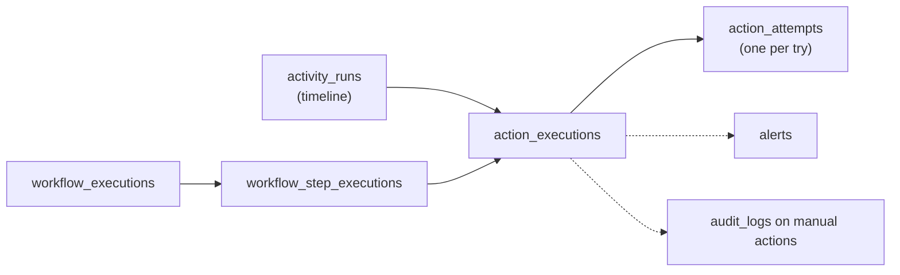

# Execution Monitoring, Retries, Failures and Recovery

> "Every action needs an execution record." (PRD §8). Workshop automation can't depend on every API succeeding on the first attempt.

Related: [reliability-patterns.md](../engineering/reliability-patterns.md) · [ADR-012](../adr/012-unknown-outcome-no-auto-retry.md) · [integration-architecture.md §5](../architecture/integration-architecture.md#5-error-classification) · Diagrams: [failure & retry](../architecture/diagrams.md#10-failure-handling-and-retry-flow), [state machine](../architecture/diagrams.md#18-execution-state-machine)

---

## 1. Purpose and scope

- A uniform execution record model for everything the system does.
- Retry policies, dead-lettering and manual recovery.
- Operational alerts and observability (traces, logs, metrics).
- The admin-facing Execution Monitor.

## 2. User stories

| # | Story |
|---|---|
| US-EX-1 | I see a table like the PRD's (Activity · Integration · Status) for any workshop, filterable and live. |
| US-EX-2 | A Sheets update failed. I see the error, the attempts and the next retry time, and can retry now. |
| US-EX-3 | 37 WhatsApp triggers have "unknown outcome" after an outage. I check their system and bulk-resolve them as delivered. |
| US-EX-4 | I'm alerted on Slack when a critical activity fails, once, not 248 times. |
| US-EX-5 | An engineer jumps from an execution to its full trace (admin command → outbox → Inngest step → HTTP call). |

## 3. Execution record model

- **States** (consistent across tables, PRD §8): `pending → scheduled → running → succeeded`, plus `failed, retrying, paused, skipped, cancelled, awaiting_confirmation, needs_attention`, and `accepted` (async provider acknowledged). See [state machine](../architecture/diagrams.md#18-execution-state-machine).
- `workflow_executions` and `action_executions` are separate (PRD §10). A failed action can be retried without re-running prior ones.
- Each attempt records: timing, HTTP status, classified outcome, redacted request/response summary, and trace ID.

## 4. Retry and failure policies

### 4.1 Default policies per action type

| Action | Max attempts | Backoff | Deadline | Idempotency class | Criticality default |
|---|---|---|---|---|---|
| `comms.trigger` | 4 | 30 s × 2^n, cap 10 min, full jitter | session start (for reminders) | per trigger (`unsafe` until verified) | normal |
| `zoom.session.ensure` | 6 | 15 s × 2^n, cap 15 min | session start − 30 min | checkable | critical |
| `zoom.attendance.import` | 12 | 5 min × 2^n, cap 2 h | 24 h | natural | normal |
| `calendar.event.ensure` | 8 | 30 s × 2^n, cap 30 min | none | natural | normal |
| `sheets.sync` | 8 | Google guidance: `min(2^n s + rand(1s), 64 s)`, then every 64 s | none | natural | low |
| `docs.generate` | 5 | 1 min × 2^n | none | checkable | low |
| `ops.notify` | 5 | 10 s × 2^n | none | natural | — |

Overridable per activity/workflow node (`retry_policy`).

### 4.2 PRD failure cases → behavior

| PRD case | Behavior |
|---|---|
| **1. WhatsApp trigger fails** | Record → retry per policy → alert admin after the limit (one grouped alert per activity run) → **don't block the timeline** |
| **2. Zoom webinar creation fails** | Session `needs_attention` → **block dependent joining instructions** → alert (critical) → manual recovery (retry / link existing / change mode) |
| **3. Google Sheets sync fails** | Postgres already saved → retry queue → continue operations → alert after 3 consecutive failures |
| **4. Workshop rescheduled** | Recompute dependent jobs → update Zoom + Calendar → cancel obsolete jobs → notify participants (optional) → record (see [timeline §11](timeline-engine.md#11-rescheduling)) |

### 4.3 Dead letter

- When retries are exhausted or the deadline is exceeded: `status=failed`, `dead_lettered_at=now()`.
- The DLQ view groups items by `action_key`, `error_code` and integration.
- Operations: retry (new attempt series, same idempotency key), skip (reason), export CSV.
- Retention: DLQ items stay until resolved or until the workshop is archived.

### 4.4 Unknown outcomes

- `needs_attention (unknown_outcome)` items have a dedicated tab.
- Bulk actions: **Mark delivered** (after the admin checks the provider), **Resend** (new attempt, same idempotency key if `keyed`, otherwise with a warning about possible duplicates), **Mark failed**.
- During a live workshop, unknown outcomes raise a **high** alert.

## 5. Execution Monitor UI

| Area | Content |
|---|---|
| Filters | Workshop, integration, action type, status (multi), activity, participant, time range, error code, criticality |
| Table | Time · Workshop · Activity/Workflow node · Integration · Target · Status · Attempts · Last error · Next retry · External ref |
| Row detail drawer | Attempts timeline, redacted request/response, classification, related activity run/workflow execution, audit entries, **"Open trace"** (link to tracing backend with trace ID), **"Open in Inngest"** (run URL) |
| Tabs | All · Problems (failed + needs_attention + retrying) · Unknown outcomes · Dead letter · Awaiting confirmation |
| Bulk ops | Retry · Skip · Resolve. Selection by checkbox **or** by "all matching filter" (async job with progress) |
| Live | SSE updates. Counts per status in the header |

## 6. Alerts

- Generated by an `AlertService` with **dedupe keys** (`activity_run:{id}:failed`), so repeated occurrences increment `occurrences` instead of creating new alerts.
- Severity mapping: critical activities → critical. Normal → high (only after retries exhausted). Low → medium (after N consecutive failures).
- Channels: in-app (bell + Overview), plus an **ops channel independent of the client's comms systems** (Slack webhook / direct SMTP / both) **[CONFIRM Q13]**. Critical alerts repeat every 15 min until acknowledged (configurable).
- Minimum alert set: [reliability-patterns §19](../engineering/reliability-patterns.md#19-execution-monitoring-and-operational-alerts).

## 7. Observability stack

| Signal | Tooling | Content |
|---|---|---|
| Traces | OpenTelemetry → OTLP backend (e.g. Grafana Tempo/Cloud, Honeycomb) **[CONFIRM Q17]** | HTTP in, DB, outbox relay, Inngest step spans (via middleware), adapter HTTP out. Attributes: `wos.workshop_id`, `wos.activity_run_id`, `wos.action_execution_id`, `inngest.run_id`, `inngest.step_id` |
| Logs | pino JSON → stdout → platform log collector | `trace_id`, `span_id`, `correlation_id`. PII masked |
| Errors | Sentry (server + SPA) | Tags: role, function ID, run ID, workshop ID |
| Metrics | OTel metrics | `activity_start_lag_seconds` (histogram, NFR-01), `action_executions_total{status,action,integration}`, `action_attempt_duration_ms`, `outbox_pending`, `webhook_received_total{provider,valid}`, `breaker_open{integration}`, `sse_connections` |
| Business log | Postgres execution tables | The source for the Execution Monitor and reports |
| Inngest | Inngest Cloud dashboard | Run-level debugging. Trace history only 24 h–14 d depending on plan **[VERIFIED]**, so our own records are primary |

SLO dashboard (proposed): scheduled-start lag p95 < 60 s. Action success rate per integration. Outbox lag < 10 s. Webhook ack p95 < 1 s.

## 8. Recovery runbooks (summary)

| Situation | Steps |
|---|---|
| Inngest outage | Watchdog alerts on overdue runs → check Inngest status → when it recovers, the sweeper re-emits. If a workshop-critical action is due during the outage: operator uses "Execute now". In degraded mode (P2), this executes directly in the api role through the same claim + gateway |
| Comms system outage | Breaker opens → retries pace → unknown outcomes → after recovery, bulk resolve |
| Zoom auth error | Reconnect S2S app → "Retry all needs_attention for Zoom" |
| Google token revoked | Reconnect OAuth → reconcile sheet bindings → retry calendar ensures |
| Bad deploy causing step failures | Roll back image → failed runs retried by Inngest (if within retries) or bulk retry from DLQ |
| DB failover | Managed failover (< 2 min typical) → steps fail transiently and retry → verify outbox drains |

Full runbooks live in `/infra/runbooks` (to be written in Phase 5).

## 9. Data entities

`activity_runs`, `workflow_executions`, `workflow_step_executions`, `action_executions`, `action_attempts`, `alerts`, `audit_logs`.

## 10. API contracts

[api-specification.md §2.8](../engineering/api-specification.md#28-execution-monitoring-alerts-and-audit).

## 11. Security

- `executions.read` (operator+), `executions.retry` (operator+), `executions.override` and `executions.resolve` (admin, or operator if configured), bulk ops > 100 items (admin).
- Request/response summaries are redacted, and full PII is never displayed in the attempts view.

## 12. Edge cases

- A retry succeeds after the deadline → not possible: retries stop at the deadline. A manual retry after the deadline asks "This reminder is past its relevance window. Send anyway?".
- A callback arrives for an action marked `needs_attention (unknown_outcome)` → auto-resolves to the reported status (and resolves the alert).
- Massive failure (e.g. 2,000 failed) → one alert per activity run, and the DLQ groups by error code.

## 13. Testing

- State transition tests for every execution entity.
- Retry policy computations (deadline, jitter bounds).
- Alert dedupe and escalation timing.
- E2E: induce failures with the mock comms server → verify monitor, alert, bulk resolve.

## 14. Acceptance criteria

1. Every adapter call appears as an action execution with ≥ 1 attempt and a trace link.
2. PRD Cases 1–4 behave as specified in automated tests.
3. Bulk resolve of 500 unknown outcomes completes within 1 min and is audited as a single bulk operation with item references.
4. Critical alerts reach the ops channel within 1 min.

## 15. Implementation dependencies

Execution tables + gateway (Phase 1–3) → alerts service → monitor UI → bulk jobs → observability wiring (SPIKE S4) → runbooks.

## 16. Trade-offs

- Own execution records in addition to Inngest's trace UI means extra writes per action, but it gives long retention, business-level queries and provider independence.
- Grouped alerts mean less noise, at the cost of less granularity in notifications (the detail lives in the monitor).

## 17. Future improvements

- Anomaly detection on success rates.
- Auto-remediation playbooks (e.g. auto-reconcile after a token refresh).
- Per-integration SLA reports for the client's vendors.
