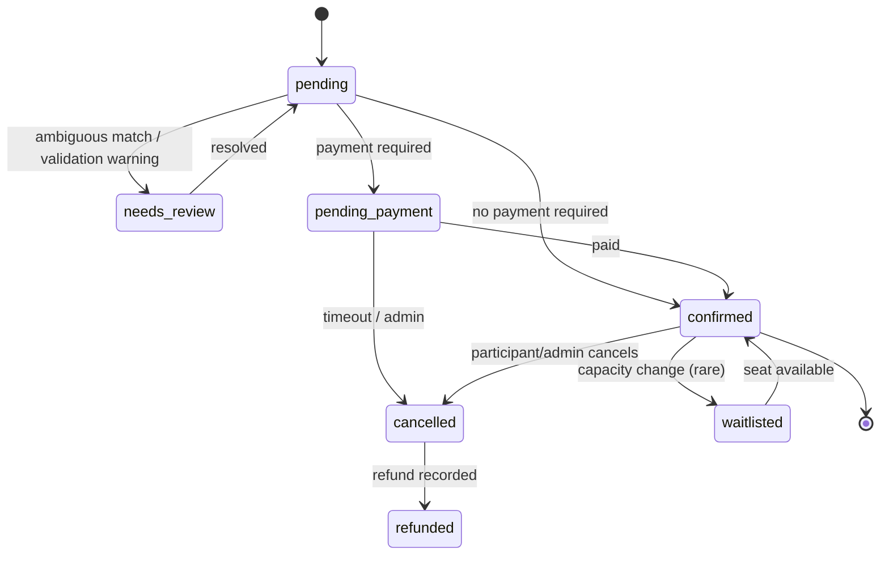

# Participant Management

Related: [google-workspace.md](google-workspace.md) · [zoom-integration.md](zoom-integration.md) · [whatsapp-email-integration.md](whatsapp-email-integration.md) · [ADR-011](../adr/011-google-sheets-sync-ownership.md) · Diagrams: [registration](../architecture/diagrams.md#13-sequence-registration), [attendance](../architecture/diagrams.md#16-sequence-attendance-synchronization)

---

## 1. Purpose and scope

Central participant records, workshop registrations, payment status (consumed, not processed), attendance (raw + computed) and completion. Participants don't log in (MVP). The platform is **not a CRM**: it stores what workshop operations need.

## 2. User stories

| # | Story |
|---|---|
| US-PM-1 | New rows in the client's Google Sheet become registrations within 5 minutes and trigger confirmation workflows. |
| US-PM-2 | A participant registered twice with different email casing is recognized as the same person. |
| US-PM-3 | An operator sees one participant's full history: registrations, messages triggered (with status), attendance, overrides. |
| US-PM-4 | After a session, attendance is imported from Zoom and matched to registrations. Unmatched attendees go to a review queue. |
| US-PM-5 | At completion, participants with ≥ 75% attendance are marked completed. Borderline cases are flagged for manual review. |
| US-PM-6 | An operator corrects a phone number (with a reason), and future triggers use it. |

## 3. Functional requirements

FR-PM-01…06 ([product-requirements.md](../planning/product-requirements.md#55-participants-doc)).

## 4. Registration intake channels

| Channel | Mechanism | Status |
|---|---|---|
| Google Sheet | Reconciliation polling (+ optional Apps Script nudge) | MVP. Likely primary **[CONFIRM Q3]** |
| CSV import | Upload → preview (diff, validation errors) → commit job | MVP |
| Intake API | `POST /webhooks/intake/registrations` (API key, Idempotency-Key) | MVP, for website/payment systems if they exist **[CONFIRM Q3]** |
| Manual | Admin form | MVP |
| Zoom registration | If participants self-register on Zoom: import Zoom registrants **[CONFIRM]** | P2 |

All channels go through **one** `RegistrationIntakeService.ingest(command)`:

1. **Normalize**: trim. Lower-case email (no Gmail dot/plus-stripping by default **[CONFIRM]**). Phone → E.164 via `libphonenumber-js` with the workshop's default country (IN) **[ASSUMPTION]**. Name → collapse whitespace.
2. **Validate**: email syntax, phone validity (mobile type preferred for WhatsApp), required fields per workshop config.
3. **Match participant**:
   - email match **and** phone match (same person) → reuse
   - only one of them matches, and the other is empty on one side → reuse + enrich
   - email matches person A while phone matches person B → `needs_review` (review queue `duplicate_participant`)
   - no match → create
4. **Upsert registration** (`UNIQUE workshop_id, participant_id`). A duplicate submission is idempotent: it updates `inbound` fields only.
5. **Payment** gate per workshop config: `not_required` → `confirmed`. Else `pending_payment` until the payment status becomes `paid` **[CONFIRM Q4: where does payment status come from?]**.
6. **Capacity** check → `waitlisted` if full (optional).
7. Outbox `registration.created` / `registration.updated` / `registration.payment_status_changed`. These trigger the Registration workflow.

## 5. Registration statuses

## 6. Attendance

### 6.1 Sources

| Source | Timing | Reliability | Use |
|---|---|---|---|
| Zoom webhooks `*.participant_joined/left` | Realtime | Best effort (delivery retries only on 5xx; may be missed) **[VERIFIED retry behavior]** | Live counters in the Control Center |
| Zoom **reports API** participants | After meeting end. Availability delay varies **[ASSUMPTION: measured in SPIKE S3]** | Authoritative. **Requires paid plan** and report scopes **[COMMUNITY]** | Final attendance |
| Zoom past-meeting participants | After end | Fewer fields **[COMMUNITY]** | Fallback if reports unavailable |
| Manual | Anytime | Operator | Overrides, in-person |

### 6.2 Matching attendees to registrations

In order of confidence:

1. `registrant_id` (if the session uses Zoom registration, each registrant has a unique join link). Confidence 1.0.
2. Attendee email = participant email (only present if the attendee was signed in or registered). 0.95.
3. Display name exact normalized match within the workshop's registrations, unique. 0.7 → auto-match only if configured. Default → review.
4. Otherwise → `unmatched_attendee` review item (operator matches manually. The match is remembered for later sessions via `provider_user_email`/name alias).

**Recommendation:** enable Zoom registration (per-registrant join URLs) for reliable attendance. Trade-off: one Zoom API call per registrant, and links must be distributed via comms variables **[CONFIRM Q5]**.

### 6.3 Computation

- `attended_seconds` = union of [join, leave] intervals per registration per session (handles rejoins and multiple devices without double counting).
- `attendance_pct` = `attended_seconds / scheduled_duration`, capped at 100%. Configurable denominator: scheduled vs actual duration **[CONFIRM Q6]**.
- Session status: `present` (≥ threshold, default 75%), `partial` (> 0), `absent`.
- Workshop `attendance_pct` = weighted by session durations (excluding cancelled sessions).
- **Completion rule** (configurable per workshop, JSON): e.g. `{ "overallAttendancePct": { "gte": 75 }, "requiredSessions": ["ses_assessment"], "assessmentPassed": true }`. Assessment data source is **[CONFIRM Q6]**.

## 7. Participant record operations

- Edit with reason. Key-field edits (email/phone) re-run dedupe checks and are audited.
- Merge (P2): reassign registrations, attendance and action executions to the surviving record. `merged_into_id` on the old record. Irreversible (audited).
- Consent flags per channel (WhatsApp/email) **[CONFIRM Q15]**. When a trigger is marked `requires_consent`, participants without consent are **skipped** (recorded as `skipped: no_consent`).
- Erasure request (P2, DPDP/GDPR-style): anonymize PII fields, keep aggregate records **[CONFIRM legal]**.

## 8. Data entities

`participants`, `registrations`, `attendance_records`, `session_attendance`, `review_queue_items`. See [database-design.md §3.4](../engineering/database-design.md#34-participants).

## 9. API contracts

[api-specification.md §2.6](../engineering/api-specification.md#26-participants-and-registrations) and the intake webhook in §3.3.

## 10. Events

Emits `registration.created|updated|confirmed|cancelled|payment_status_changed`, `registration.closed` (when the workshop's registration window closes; a scheduled activity or admin action), `attendance.imported {sessionId}`, `registration.completion_evaluated`. Consumes `zoom.participant.joined/left`, `zoom.session.ended`, sheet reconciliation results.

## 11. Error scenarios

| Scenario | Behavior |
|---|---|
| Invalid phone | Registration created with `phone_e164=null`, warning. WhatsApp triggers skip with `skipped: invalid_phone` |
| Sheet row with missing email and phone | Review queue `ambiguous_row`. No registration |
| Concurrent imports of the same person | Unique indexes + `ON CONFLICT` → one participant |
| Zoom report empty after 24 h of retries | `needs_attention` on attendance activity. Admin can mark manual attendance |
| Payment status flips paid → refunded | `registration.payment_status_changed` → workflow decides (e.g. cancel + notify) |

## 12. Security and privacy

- PII: names, emails, phones. Encrypted at rest (disk-level managed DB encryption), masked in logs and action summaries, never in Inngest event payloads ([data-flow §1](../architecture/data-flow.md#1-principles)).
- Per-registrant Zoom join URLs are treated as secrets (encrypted column) because they let someone join as that registrant.
- Export permission `participants.export` (CSV with PII) is admin only and audited.

## 13. Edge cases

- Same participant in two concurrent workshops → two registrations. Attendance matched per session, so it's unaffected.
- Shared email (family members) → phone differs → review (`duplicate_participant`) with an "allow shared email" resolution.
- International numbers without `+` → parsed with the default country. If ambiguous → review.
- A participant who joined from two devices simultaneously → interval union prevents > 100%.

## 14. Testing

- Normalization and matching table tests (≥ 40 cases).
- Interval-union property tests.
- Import idempotency: the same CSV twice → zero changes the second time.
- Attendance import with recorded Zoom report fixtures, including pagination.

## 15. Acceptance criteria

1. Importing a 1,000-row sheet creates/updates registrations with 0 duplicates and reports validation issues per row.
2. A participant's history page shows every comms action with its latest delivery status.
3. Attendance % for a participant who joined, left and rejoined is computed from merged intervals.
4. Completion statuses follow the configured rule. Borderline cases appear in the review queue.

## 16. Implementation dependencies

DB → intake service → CSV import → Sheets adapter + reconciliation → Zoom attendance import → completion rules → review queue UI.

## 17. Trade-offs

- Not stripping Gmail dots/plus by default avoids false merges at the cost of some missed duplicates.
- Name-based attendance matching is off by default (precision over recall), at the cost of more manual review.

## 18. Future improvements

- Participant self-service portal (join links, materials, certificates).
- Fuzzy matching with ML scoring for unmatched attendees.
- CRM sync if the client has one.
