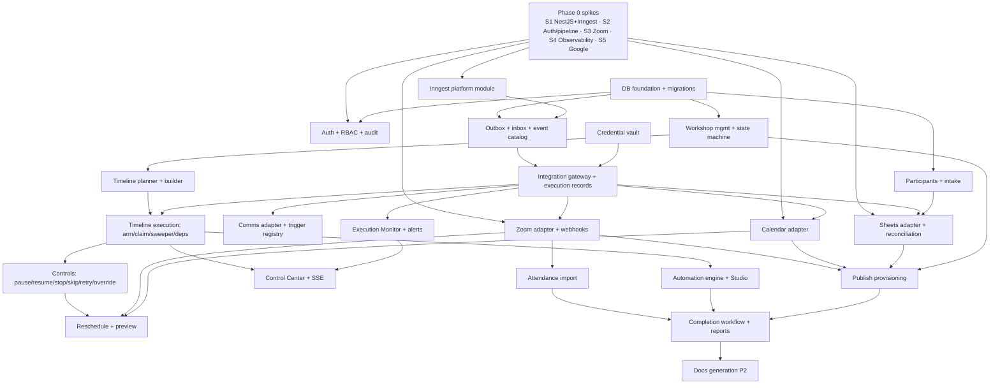

# Development Roadmap

Related: [product-requirements.md](product-requirements.md) · [risks-and-tradeoffs.md](risks-and-tradeoffs.md) · [open-questions.md](open-questions.md)

Phases follow the PRD §12 stages, with a **Phase 0** added for the technical spikes that de-risk the architecture before feature work. Durations assume a team of 2–3 full-stack engineers and are indicative only.

---

## Feature dependency graph

## Phase 0: Technical spikes

Time-boxed. Each produces a short written result and a working proof in a throwaway branch.

| Spike | Question | Exit criteria | Blocks |
|---|---|---|---|
| **S1: NestJS + Inngest** | Does `inngest/express` v4 work in NestJS 11 / Express 5, with DI via factories, signature verification, restart during sleep, CI sync, `@inngest/test`? | All criteria in [ADR-005](../adr/005-nestjs-inngest-express-serve.md#spike-s1-acceptance-criteria-must-pass-before-phase-2) | All execution work |
| **S2: Auth + HTTP pipeline** | Better Auth + per-route parsers + webhook raw body + Inngest in one process. Zod→OpenAPI library with Zod v4 | [ADR-006](../adr/006-auth-better-auth-and-body-parsing.md#spike-s2-acceptance-criteria) criteria | Phase 1 |
| **S3: Zoom capabilities** | On the client's actual plan: meeting/webinar CRUD, end status, registrants, report availability delay, recording webhook, Simulive linked-webinar behavior (PATCH start_time, `is_simulive` readable, `simulive_delay_start`) | Capability matrix filled with real results. Confirmed scopes list | Zoom adapter, Simulive design |
| **S4: Observability** | OTel + Sentry coexistence. Trace propagation through Inngest steps | One trace from API call → outbox → step → HTTP mock | Phase 5 |
| **S5: Google** | OAuth app type (Internal/External), refresh token persistence, Picker + `drive.file` access to existing sheets, Calendar deterministic IDs incl. delete/reinsert | Working OAuth + sheet read/write + calendar idempotency proof | Sheets/Calendar adapters |

**Duration:** 1.5–2 weeks (parallelizable). **Prerequisite:** answers to open questions Q1, Q3, Q5, Q8 (at least partially).

## Phase 1: Foundation (3 weeks)

- Monorepo, CI, Docker, environments (local/staging), config validation.
- Drizzle schema v1 (core tables), migrations pipeline.
- Better Auth, RBAC, users/invites, audit log.
- Platform modules: Inngest module (from S1), outbox relay, webhook inbox, SSE + LISTEN/NOTIFY.
- Credential vault (envelope encryption). Integrations CRUD skeleton.
- Integration gateway + `action_executions`/`action_attempts` + error classification.
- SPA shell: auth, layout, navigation, role-aware routing.

**Exit:** a dummy "ping" action can be scheduled from the API, executed by the worker through the gateway, recorded, and shown live in the SPA.

## Phase 2: Workshop engine (3–4 weeks)

- Workshops, days, sessions, trainers, resources (R2 uploads). State machine. Validation framework.
- Timeline data model, `TimelinePlanner` (tz/DST), activity types (config schemas), dependencies + cycle detection.
- Timeline builder UI (dnd-kit), activity forms, template activities (pre-workshop offsets).
- Duplicate workshop.

**Exit:** a full multi-day timeline can be built and validated, with correct computed times (golden tests).

## Phase 3: Orchestration (3–4 weeks)

- Arming, claim/fencing, horizon cron, overdue sweeper, watchdog.
- Execution algorithm incl. fan-out child runs, success conditions, missed policy.
- Dependency resolver (sequential mode), event-mode listeners.
- Controls: activate, pause, resume, stop, emergency stop, skip, retry, execute now, override, manual tasks.
- Reschedule with impact preview (internal parts. External propagation in Phase 4).
- Automation engine core: DSL, validator, router, interpreter (action/condition/delay/wait/for_each), versioning/publish. Basic React Flow editor.

**Exit:** chaos test passes on a synthetic workshop with mock adapters (0 duplicates, 0 lost).

## Phase 4: Integrations (4–5 weeks)

- **Comms adapter** (generic webhook, mapped to the client's platform per Q1), trigger registry + verification flow, callbacks.
- **Zoom adapter**: S2S auth, ensure meeting/webinar, registrants, host start, end, webhooks, linked Simulive + verify, drift detection.
- **Google Calendar**: ensure/patch/cancel with deterministic IDs.
- **Google Sheets**: bindings + column map editor + preview, reconciliation, outbound debounced export.
- Participants: intake service (sheet/CSV/API/manual), dedupe, review queue.
- Publish provisioning workflow. Reschedule propagation workflow. Registration workflow.

**Exit:** a staging workshop publishes against real test accounts and runs reminders through the client's test triggers.

## Phase 5: Operations (2–3 weeks)

- Execution Monitor (filters, drawer, DLQ, unknown outcomes, bulk ops), alerts service + ops channel.
- Control Center (live), Overview, integration health, sync matrix.
- Observability wiring (from S4), SLO dashboards, runbooks.
- Audit log UI.

**Exit:** the operational readiness checklist ([deployment.md §9](../engineering/deployment.md#9-operational-readiness-checklist-pre-go-live)) is mostly green.

## Phase 6: Completion and hardening (2–3 weeks)

- Attendance import (reports + webhooks), interval computation, matching, review.
- Completion rules + workflow, reports (summary, attendance, CSV export), sheet final export.
- Recording processing + publish (share-link mode).
- Load tests, chaos tests, security review, pen test fixes, restore drill.
- UAT with a pilot workshop. Production go-live.
- Re-evaluate Inngest Connect mode.

**MVP total:** roughly **18–24 weeks** including Phase 0.

## Post-MVP (Phase 7+)

| Item | Priority |
|---|---|
| Google Docs generation (schedule, attendance, completion report, summary) | P2 |
| Advanced workflow nodes (switch, approvals, sub-workflows), test-run mode | P2 |
| Workshop templates | P2 |
| Calendar free/busy trainer checks | P2 |
| Participant merge | P2 |
| Degraded-mode direct execution (Inngest outage) | P2 |
| Recording copy to R2 | P2 |
| Audit hash chain | P2 |
| Certificates | Future |
| Participant self-service portal | Future |
| Advanced analytics | Future |
| Native comms adapters, CRM sync | Future |

## Recommended implementation sequence (condensed)

1. Answer the blocking open questions (Q1, Q3, Q5, Q8, Q11, Q12) → run spikes S1–S5.
2. Foundation: DB → auth/RBAC/audit → Inngest module → outbox/inbox → gateway + execution records → SSE.
3. Workshop structure → planner → timeline builder.
4. Execution core: arm/claim/sweeper → fan-out → dependencies → controls → reschedule (internal).
5. Comms adapter (unblocks the most-used activity types) → Zoom → Calendar → Sheets + intake.
6. Publish/reschedule/registration built-in workflows → automation engine UI.
7. Execution Monitor + alerts + Control Center.
8. Attendance → completion → reports → hardening → pilot.

## MVP vs future scope

| MVP (PRD "Recommended MVP" 1–13) | Future |
|---|---|
| Single-business admin dashboard | Participant self-service portal |
| Workshop creation & configuration | Certificates |
| Multi-day timeline builder | Advanced analytics |
| Activity scheduling & dependencies | Google Docs generation (P2) |
| Inngest-based orchestration | Advanced conditional workflows (switch, approvals, test-run) (P2) |
| Existing WhatsApp integration | Workshop templates (P2) |
| Existing email integration | Free/busy scheduling (P2) |
| Zoom meeting/webinar integration (+ linked Simulive verification) | Recording copy to R2 (P2) |
| Google Sheets import/export/sync | Native comms adapters, CRM sync |
| Google Calendar sync | Inngest Connect migration (evaluate) |
| Central execution monitoring | Multi-language |
| Pause/resume/retry/manual override | |
| Activity logs (audit) | |
| *Plus (required for a usable MVP):* attendance import + basic completion + basic reports | |
